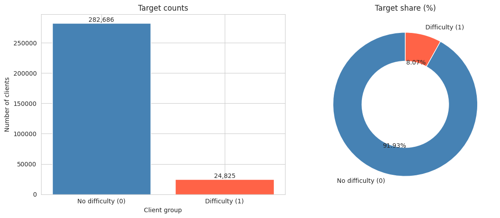
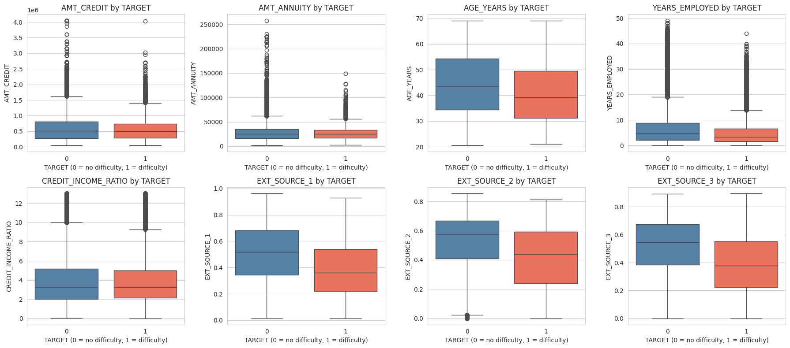
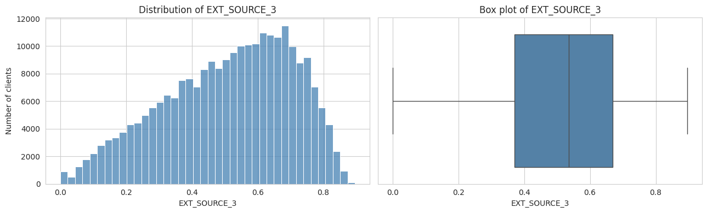
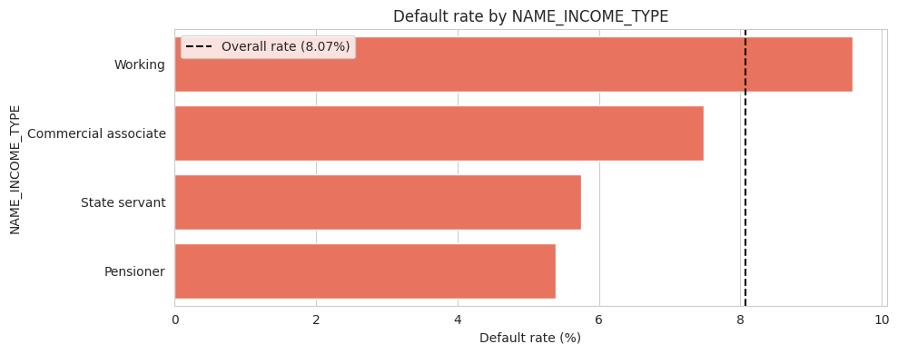
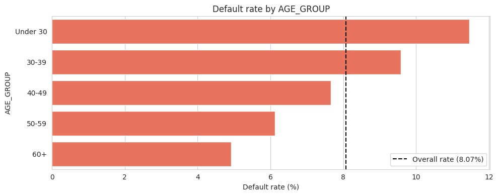
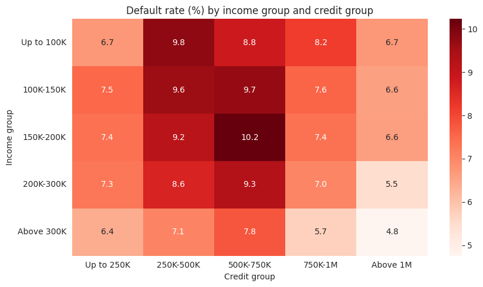
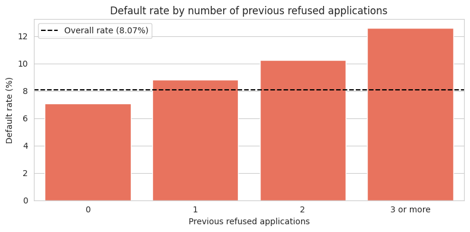
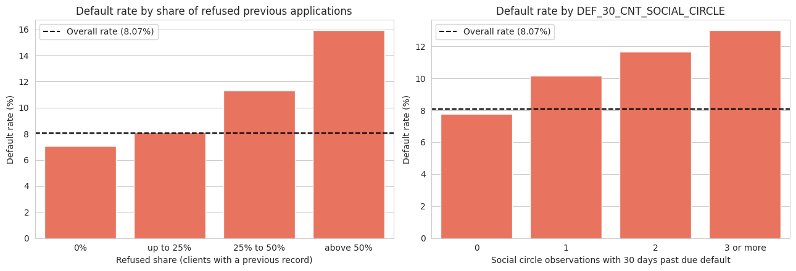

# Loan Default Analysis

## 1. Project Overview

This project explores customer characteristics and previous loan application records to identify patterns associated with loan payment difficulties.

The analysis uses two datasets from the Home Credit Default Risk dataset. It focuses on understanding customer demographics, financial characteristics, loan information, and previous application history through exploratory data analysis (EDA).

## 2. Problem Statement

Financial institutions need to understand the characteristics associated with customers who experience difficulties repaying their loans.

This project investigates the differences between customers who experience payment difficulties and those who do not. It also examines whether previous loan application history provides additional insights into customer repayment behaviour.

## 3. Objectives

- Understand the structure and quality of the available datasets.
- Examine customer demographic and financial characteristics.
- Identify patterns associated with loan payment difficulties.
- Analyse previous loan application records.
- Communicate findings through data visualisations.

## 4. Dataset Description

This project uses two datasets:

| Dataset | Description |
|---|---|
| `application_data` | Contains customer demographic, financial, and current loan application information. |
| `previous_application` | Contains historical loan application records from previous applications. |

### Target Variable

The target variable is `TARGET`, which indicates whether a customer experienced payment difficulties.

| Target | Description | Count | Percentage |
|---|---|---:|---:|
| 0 | No payment difficulties | 282,686 | 91.93% |
| 1 | Payment difficulties | 24,825 | 8.07% |
| Total | | 307,511 | 100% |

The dataset contains an imbalanced target distribution, with most customers belonging to the no-payment-difficulties group.

## 5. Tools and Technologies

- Python
- Google Colab
- Pandas
- NumPy
- Matplotlib
- Seaborn

## 6. Data Preparation

The data preparation process included:

- Inspecting dataset dimensions, column names, and data types.
- Checking missing values and duplicate records.
- Examining numerical variables for outliers and unusual distributions.
- Preparing variables for exploratory analysis.
- Creating grouped variables, such as age, income, and credit amount categories.
- Preparing relevant information from previous application records for further analysis.

## 7. Exploratory Data Analysis

The exploratory data analysis was divided into several areas.

### 7.1 Data Quality Analysis

Examined missing values, outliers, and other data quality issues to understand the condition of the datasets.

### 7.2 Univariate Analysis

Examined individual variables to understand their distributions and identify common customer characteristics.

Variables included:

- Client income
- Credit amount
- Annuity amount
- Goods price
- Client age
- Years employed
- Credit-to-income ratio
- External credit scores

### 7.3 Bivariate Analysis

Compared customer characteristics against the target variable to identify differences between customers with and without payment difficulties.

### 7.4 Grouped Variable Analysis

Grouped numerical variables into categories to examine payment difficulty rates across different customer segments.

Examples included:

- Age groups
- Income groups
- Credit amount groups

### 7.5 Previous Application Analysis

Examined historical loan application information to explore patterns related to previous application outcomes and customer payment difficulties.

## 8. Key Findings

The analysis identified several differences between customers with and without payment difficulties.

- Contract Type: Customers with cash loans had a higher payment difficulty rate (8.35%) than customers with revolving loans (5.48%).
- Gender: Male customers had a higher payment difficulty rate (10.14%) than female customers (7.00%).
- Age Group: Customers below 30 had the highest payment difficulty rate (11.46%), while customers aged 60 and above had the lowest rate (4.92%).
- External Credit Score: Customers with payment difficulties had a lower median EXT_SOURCE_3 score (0.379) than customers without payment difficulties (0.546).

These findings describe patterns observed in the dataset. They do not establish that any particular characteristic causes payment difficulties.

## 9. Discussion

The findings highlight differences in payment difficulty rates across customer demographics, financial characteristics, and loan contract types.

Younger customers showed higher payment difficulty rates than older customers. Male customers also showed a higher rate than female customers in this dataset.

External credit scores showed a noticeable difference between the two target groups. Customers with payment difficulties had a lower median EXT_SOURCE_3 score, suggesting that this variable may be useful for further investigation of repayment risk.

The differences between cash and revolving loans also indicate that payment difficulty rates vary across loan contract types.

Previous application records provide another source of information for understanding customer application history. However, these observations should be interpreted alongside the limitations of the available data.

Overall, the analysis identifies associations between customer characteristics and payment difficulties. Further statistical analysis or predictive modelling would be needed to evaluate these relationships in greater detail.

## 10. Selected Visualisations

The following charts highlight selected results from the exploratory data analysis.

### Target Distribution



Shows the distribution of customers with and without payment difficulties.

### Feature Distributions by Target



Compares selected numerical feature distributions between the two target groups.

### External Credit Score



Shows the distribution of the EXT_SOURCE_3 variable.

### Payment Difficulty Rate by Income Type



Compares payment difficulty rates across different income types.

### Payment Difficulty Rate by Age Group



Shows how payment difficulty rates vary across age groups.

### Payment Difficulty Rate by Income and Credit Groups



Explores payment difficulty rates across combinations of income and credit amount groups.

### Previous Refused Applications



Examines the relationship between previous refused applications and payment difficulty rates.

### Previous Refused Applications and Social Circle



Explores payment difficulty rates in relation to previous refused applications and social circle information.

## 11. Conclusion

This project explored customer characteristics and previous loan application records to understand patterns associated with loan payment difficulties.

The analysis identified differences across age groups, gender, contract types, and external credit scores. It also examined historical application information to explore additional patterns.

The findings provide an initial understanding of customer characteristics associated with payment difficulties. They can serve as a starting point for further analysis and classification modelling to investigate loan repayment risk.

## 12. Project Structure

```text
loan-default-analysis/
├── README.md
├── loan-default-analysis.ipynb
└── figures/
    ├── 00-missing-values.png
    ├── 01-outlier-distributions.png
    ├── 02-target-distribution.png
    ├── 03-client-income-distribution.png
    ├── 04-credit-amount-distribution.png
    ├── 05-annuity-amount-distribution.png
    ├── 06-goods-price-distribution.png
    ├── 07-client-age-distribution.png
    ├── 08-years-employed-distribution.png
    ├── 09-credit-income-ratio-distribution.png
    ├── 10-ext-source-1-distribution.png
    ├── 11-ext-source-2-distribution.png
    ├── 12-ext-source-3-distribution.png
    ├── 13-clients-by-contract-type.png
    ├── 14-clients-by-gender.png
    ├── 15-clients-by-car-ownership.png
    ├── 16-clients-by-property-ownership.png
    ├── 17-clients-by-income-type.png
    ├── 18-clients-by-education-type.png
    ├── 19-clients-by-family-status.png
    ├── 20-clients-by-housing-type.png
    ├── 21-clients-by-occupation-type.png
    ├── 22-clients-by-age-group.png
    ├── 23-clients-by-income-group.png
    ├── 24-clients-by-credit-group.png
    ├── 25-feature-distributions-by-target.png
    ├── 26-default-rate-by-contract-type.png
    ├── 27-default-rate-by-gender.png
    ├── 28-default-rate-by-car-ownership.png
    ├── 29-default-rate-by-property-ownership.png
    ├── 30-default-rate-by-income-type.png
    ├── 31-default-rate-by-education-type.png
    ├── 32-default-rate-by-family-status.png
    ├── 33-default-rate-by-housing-type.png
    ├── 34-default-rate-by-occupation-type.png
    ├── 35-default-rate-by-age-group.png
    ├── 36-default-rate-by-credit-group.png
    ├── 37-default-rate-income-credit-heatmap.png
    ├── 38-credit-amount-vs-goods-price.png
    ├── 39-feature-correlations-by-target.png
    ├── 40-default-rate-by-previous-refused-applications.png
    └── 41-default-rate-refused-applications-social-circle.png
```

## 13. How to Run

1. Clone the repository:

   ```bash
   git clone <your-repository-url>
   ```

2. Navigate to the project directory:

   ```bash
   cd data-analytics-projects/01-exploratory-data-analysis/loan-default-analysis
   ```

3. Open `loan-default-analysis.ipynb` using Google Colab or Jupyter Notebook.

4. Obtain the required datasets and place them in the appropriate directory.

5. Update the dataset file paths in the notebook if necessary.

6. Install the required Python libraries if they are not already available.

   ```bash
   pip install pandas numpy matplotlib seaborn
   ```

7. Run the notebook cells in order.

## 14. Limitations

- The dataset contains an imbalanced target variable, with only 8.07% of customers experiencing payment difficulties.
- The analysis identifies associations and patterns, not causal relationships.
- Findings depend on the variables and information available in the datasets.
- Exploratory data analysis alone cannot establish how accurately customer payment difficulties can be predicted.