# Customer Segmentation Using K-Means Clustering

## 1. Project Overview

This project groups active credit card holders by their usage behaviour using K-Means clustering. The dataset covers 8,950 customers and 18 variables over the last 6 months. The final model finds five segments that differ in spending, cash advance use, and repayment habits.

## 2. Business Problem

XYZ Marketings wants to understand how its credit card customers use their cards. Without segments, every customer receives the same offers. Grouping customers by behaviour allows more targeted offers such as saving plans, loans, and wealth management products.

## 3. Objectives

- Clean and prepare the customer data for clustering.
- Explore the distributions and relationships that affect clustering.
- Select features, reduce skew, and scale the data.
- Choose the number of clusters using inertia, silhouette score, and cluster sizes.
- Evaluate cluster quality, including per-cluster silhouette scores.
- Profile each cluster in real amounts and give it a business name.
- Suggest how each segment could be targeted.

## 4. Dataset Description

| Item | Detail |
|---|---|
| Customers | 8,950 |
| Variables | 18 (1 identifier, 17 numerical) |
| Period | Last 6 months |
| Target | None (unsupervised) |

The variables fall into four groups: balance, purchases, cash advances, and payments, plus credit limit and tenure. The dataset is not included in this repository. See [`data/README.md`](data/README.md) for column descriptions and quality notes.

## 5. Tools and Technologies

| Tool | Use |
|---|---|
| Python | Main language |
| pandas, NumPy | Data handling |
| Matplotlib, seaborn | Visualisation |
| scikit-learn | `StandardScaler`, `KMeans`, silhouette metrics |
| Jupyter Notebook | Analysis and reporting |

## 6. Data Cleaning and Preparation

| Issue | Finding | Action |
|---|---|---|
| Duplicates | No duplicate rows or customer IDs | None |
| Negative values | None in amount or count columns | None |
| Missing `CREDIT_LIMIT` | 1 row | Filled with the median |
| Missing `MINIMUM_PAYMENTS` | 313 rows (3.5%) | Filled with the median |
| `CASH_ADVANCE_FREQUENCY` above 1 | 8 rows, maximum 1.5 | Capped at 1, customers kept |
| Identifier | `CUST_ID` | Excluded from clustering |

Of the 313 customers with missing `MINIMUM_PAYMENTS`, 240 had `PAYMENTS` equal to 0, so the gaps likely mean no payment activity. The median is a simple choice, and 0 would be a reasonable alternative (see [Limitations](#14-limitations-and-future-improvements)).

## 7. Exploratory Data Analysis

The EDA focused on four findings that shaped the modelling decisions.

### 7.1 Heavy skew and outliers

`MINIMUM_PAYMENTS` (skew 13.85), `ONEOFF_PURCHASES` (10.05), and `PURCHASES` (8.14) are the most skewed. Most customers sit near zero and a few spend or borrow very large amounts.

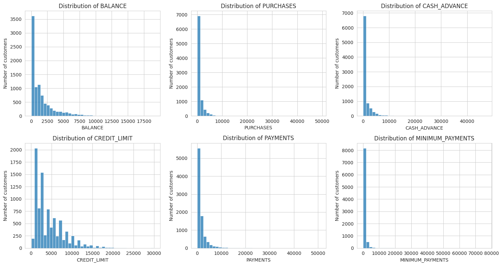

*Histograms of the six key money variables. Most customers sit near zero, with a long tail of a few very large values.*

Between 808 and 1,030 customers per key money column sit above the box plot limit (9% to 12%). These are a real part of the customer base, not rare errors, so they were kept.

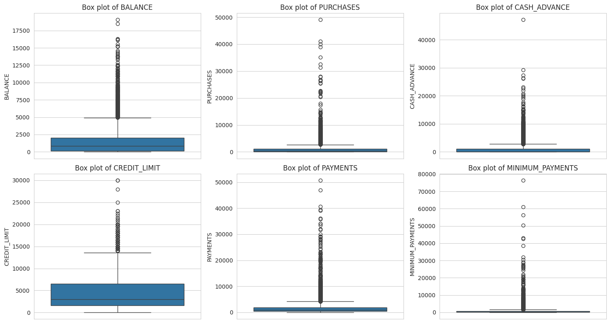

*Box plots of the six key money variables. Many points lie above the upper whisker, showing a large group of high-value customers.*

### 7.2 Purchase users and cash advance users differ

`PURCHASES_FREQUENCY` has two peaks, near 0 and near 1, which suggests natural customer types. Most customers have `PRC_FULL_PAYMENT` near 0, and only a small group pays in full.

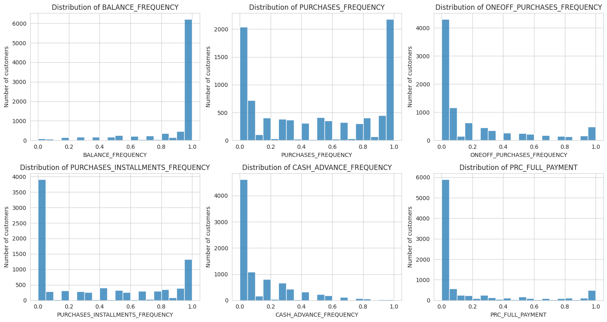

*Histograms of the six frequency variables. `BALANCE_FREQUENCY` is mostly near 1, `PURCHASES_FREQUENCY` has two peaks (near 0 and near 1), and most customers have cash advance and full payment values near 0.*

Cash advance features have weak or negative correlation with purchase features (-0.31 between `PURCHASES_FREQUENCY` and `CASH_ADVANCE_FREQUENCY`). This should help K-Means separate shoppers from cash advance users.

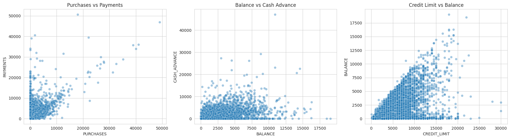

*Three scatter plots. Purchases vs payments shows a positive trend, balance vs cash advance shows no clear pattern, and credit limit vs balance forms a triangle because balance rarely exceeds the limit.*

### 7.3 Overlapping features

Several features carry the same information and would be counted twice in a distance-based model:

| Pair | Correlation |
|---|---|
| `PURCHASES` and `ONEOFF_PURCHASES` | 0.92 |
| `PURCHASES_FREQUENCY` and `PURCHASES_INSTALLMENTS_FREQUENCY` | 0.86 |
| `CASH_ADVANCE_FREQUENCY` and `CASH_ADVANCE_TRX` | 0.80 |

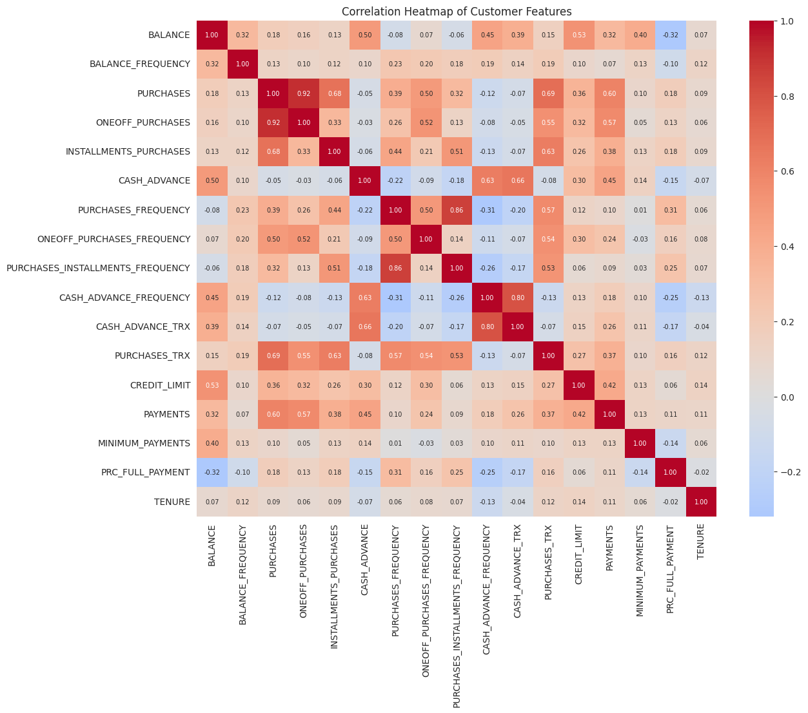

*Correlation heatmap of all 17 numerical features. Red means positive correlation and blue means negative. The strongest pairs are `PURCHASES` with `ONEOFF_PURCHASES` (0.92) and the purchase frequency pair (0.86).*

### 7.4 Near-constant tenure

84.7% of customers have a tenure of 12 months, so `TENURE` adds little to separating groups.

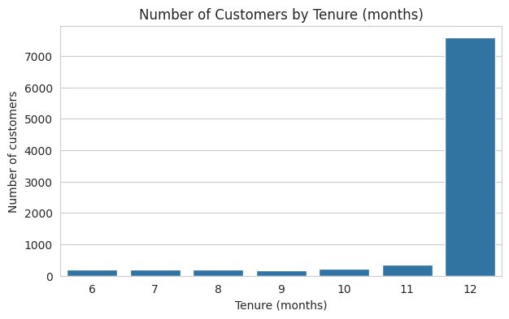

*Bar chart of customers by tenure. Almost all customers (84.7%) have 12 months.*

## 8. Modelling Approach

**Feature selection.** Ten behaviour features were kept: `BALANCE`, `BALANCE_FREQUENCY`, `PURCHASES`, `PURCHASES_FREQUENCY`, `CASH_ADVANCE`, `CASH_ADVANCE_FREQUENCY`, `CREDIT_LIMIT`, `PAYMENTS`, `MINIMUM_PAYMENTS`, and `PRC_FULL_PAYMENT`.

| Dropped | Reason |
|---|---|
| `CUST_ID` | Identifier |
| `TENURE` | 84.7% of customers share one value |
| `ONEOFF_PURCHASES`, `INSTALLMENTS_PURCHASES`, `PURCHASES_TRX` | Overlap with `PURCHASES` (0.92, 0.68, 0.69) |
| `ONEOFF_PURCHASES_FREQUENCY`, `PURCHASES_INSTALLMENTS_FREQUENCY` | Overlap with `PURCHASES_FREQUENCY` |
| `CASH_ADVANCE_TRX` | Overlaps with `CASH_ADVANCE_FREQUENCY` (0.80) |

**Log transform.** `np.log1p` was applied to the six money columns. Outliers were not removed.

| Feature | Skew before | Skew after |
|---|---|---|
| `MINIMUM_PAYMENTS` | 13.85 | 0.27 |
| `PURCHASES` | 8.14 | -0.76 |
| `PAYMENTS` | 5.91 | -1.78 |
| `CASH_ADVANCE` | 5.17 | 0.26 |
| `BALANCE` | 2.39 | -0.86 |
| `CREDIT_LIMIT` | 1.52 | -0.10 |

`PAYMENTS` flipped to left skew because many customers have a payment of 0, and `log1p(0)` is 0. It is still much better than before, so it was kept.

**Scaling.** All features were scaled with `StandardScaler` (mean 0, standard deviation 1).

**Choosing k.** K-Means was run for k = 2 to 10 with `random_state=42` and `n_init=10`.

| k | Inertia | Silhouette |
|---|---|---|
| 2 | 66,344 | 0.252 |
| 3 | 54,968 | 0.251 |
| 4 | 47,702 | 0.240 |
| 5 | 41,544 | 0.249 |
| 6 | 38,507 | 0.224 |
| 7 | 35,921 | 0.233 |
| 8 | 33,444 | 0.217 |
| 9 | 31,750 | 0.221 |
| 10 | 30,297 | 0.212 |

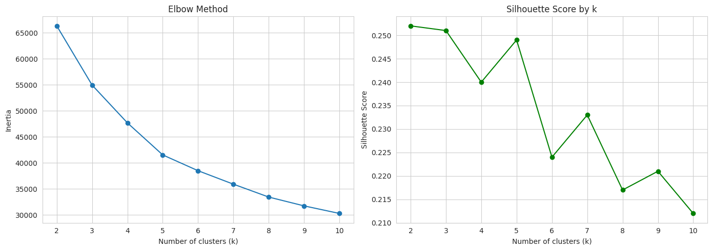

*Left: inertia for k = 2 to 10, which falls steadily with no sharp bend. Right: silhouette score by k, which is highest at k = 2, 3 and 5 and lower from k = 6.*

**Decision: k = 5.**

- The elbow is soft, but the drop in inertia roughly halves after k = 5 (6,158 from k = 4 to 5, then 3,037 from k = 5 to 6).
- The silhouette score at k = 5 (0.249) is almost equal to k = 2 and k = 3.
- Every cluster holds at least 13% of customers.
- Two or three segments are too broad for targeted offers.

## 9. Model Evaluation

Clustering has no true labels, so classification accuracy does not apply. The model was judged on inertia, silhouette score, and cluster sizes.

**Comparison of candidate k values**

| k | Inertia | Silhouette | Smallest cluster | Largest cluster |
|---|---|---|---|---|
| 3 | 54,968 | 0.251 | 16.1% | 45.0% |
| 4 | 47,702 | 0.240 | 14.5% | 37.4% |
| 5 | 41,544 | 0.249 | 13.0% | 30.9% |

Compared with k = 3, k = 5 has about 24% lower inertia and a more balanced largest cluster (45.0% down to 30.9%) at almost the same silhouette score. k = 4 has the lowest silhouette score with no clear benefit.

**Cluster sizes (k = 5)**

Cluster sizes range from 1,165 (13.0%) to 2,768 (30.9%), so no cluster is tiny or dominant.

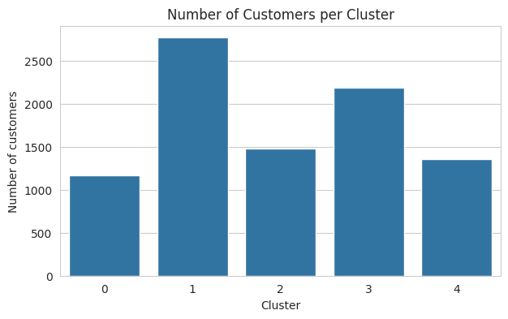

*Number of customers in each of the five clusters. Cluster 1 is the largest and cluster 0 the smallest, but none is tiny or dominant.*

**Per-cluster quality (k = 5)**

| Cluster | Mean silhouette | Customers with negative score |
|---|---|---|
| 0 | 0.156 | 20.5% |
| 1 | 0.237 | 1.2% |
| 2 | 0.227 | 1.0% |
| 3 | 0.287 | 0.6% |
| 4 | 0.316 | 0.0% |

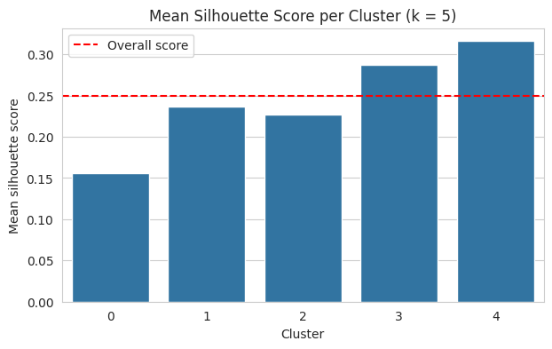

*Mean silhouette score for each cluster, with the overall score as a red dashed line. Clusters 3 and 4 are above the line, and cluster 0 is the weakest.*

Clusters 3 and 4 are the best separated. Cluster 0 is the weakest: one in five of its customers sits closer to another cluster. The overall score of 0.249 means moderate structure with overlap, which is common for customer behaviour data.

## 10. Cluster Profiles (Key Findings)

Cluster numbers are only labels and have no order. Names are interpretations based on median values and the scaled heatmap.

| Cluster | Customers | Name | Key evidence (medians) |
|---|---|---|---|
| 0 | 1,165 (13.0%) | Low-activity | Balance 16, purchases 140, balance frequency 0.36 |
| 1 | 2,768 (30.9%) | Regular buyers with a balance | Purchases 695, balance 916, no cash advance |
| 2 | 1,477 (16.5%) | High-limit heavy users | Credit limit 6,000, balance 2,881, cash advance 1,882 |
| 3 | 2,182 (24.4%) | Cash advance users | No purchases, cash advance 1,238, balance 1,520 |
| 4 | 1,358 (15.2%) | Full payers | Purchase frequency 1.00, full payment 0.80, balance 87 |

The heatmap shows what each cluster is high or low in. Red is above average and blue is below average.

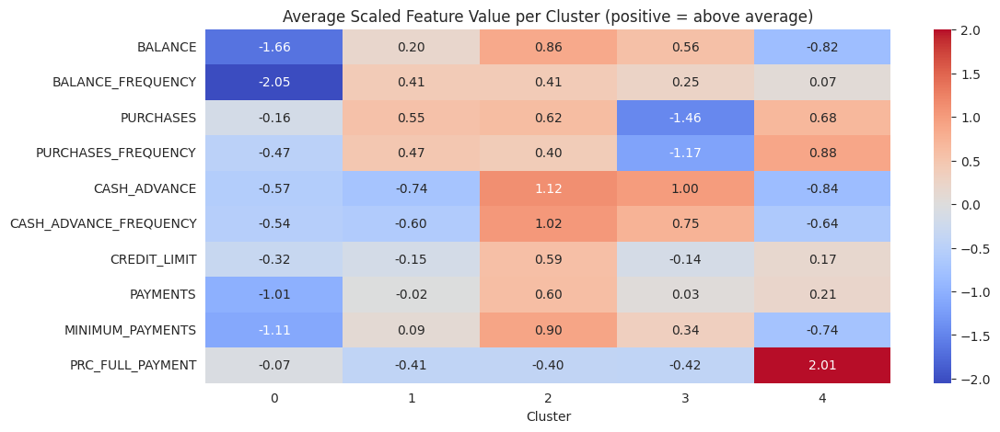

*Average scaled value of each feature per cluster. Red is above average and blue is below. For example, cluster 4 is far above average on `PRC_FULL_PAYMENT`, and cluster 0 is well below average on balance.*

The median bar charts show the differences in real amounts.

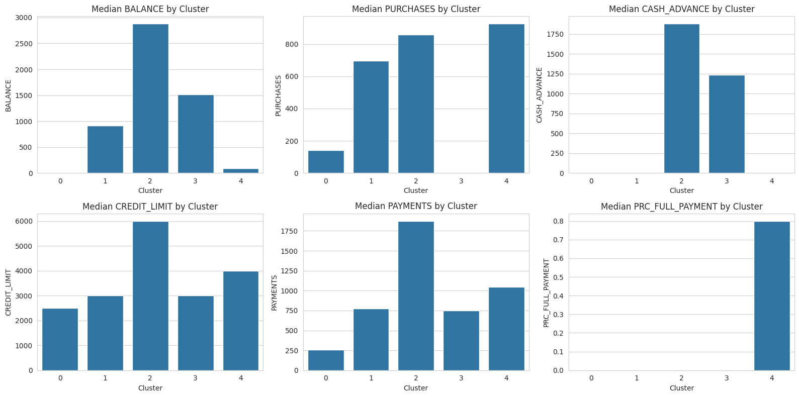

*Median balance, purchases, cash advance, credit limit, payments, and full payment ratio per cluster. Cluster 2 is highest on most amounts, cluster 3 has zero purchases, and only cluster 4 pays in full.*

Each scatter plot shows only two of the ten features, so clusters overlap in any single view. The heatmap and profile tables are the stronger evidence.

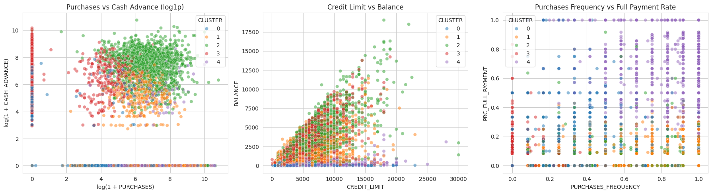

*Customers coloured by cluster on three feature pairs: purchases vs cash advance (log scale), credit limit vs balance, and purchase frequency vs full payment rate. Clusters overlap in any single view.*

Features not used in clustering support these profiles:

- Cluster 3 averages 6.57 cash advance transactions and 0.30 purchase transactions.
- Cluster 4 averages 25.02 purchase transactions and 0.13 cash advance transactions.
- `TENURE` stays between 11.27 and 11.71 in every cluster, so it does not drive the groups.

The main split in the data is between purchase behaviour, cash advance behaviour, and repayment behaviour.

## 11. Business Recommendations

These are suggestions based on the profiles. They have not been tested and should be validated with business data before use.

| Segment | Possible approach |
|---|---|
| Low-activity | Re-engagement offers and incentives for first purchases |
| Regular buyers with a balance | Instalment plans and balance-transfer or repayment offers |
| High-limit heavy users | Premium products, wealth management, and credit limit reviews with risk monitoring |
| Cash advance users | Personal loan or debt consolidation offers, which may be cheaper than cash advances. Monitor credit risk |
| Full payers | Rewards, cashback, and savings or investment products. Low interest income, but low risk |

## 12. Answer to the problem

| Question | Answer |
|---|---|
| Can credit card holders be grouped by usage behaviour? | **Yes, into five segments.** K-Means with k = 5 gives groups of 13.0% to 30.9% of customers, with moderate separation (silhouette 0.249). |
| What are the segments? | **Low-activity, regular buyers with a balance, high-limit heavy users, cash advance users, and full payers.** The main split is between purchase, cash advance, and repayment behaviour. |
| Which segments are clearest? | **Cash advance users (cluster 3) and full payers (cluster 4)**, with silhouette scores of 0.287 and 0.316. The low-activity group (cluster 0, 0.156) overlaps most with others. |
| Can the segments support targeted offers? | **Yes, as a first step.** They give a starting point for savings, loan, and wealth management offers (see section 11). Segments describe tendencies, not sharp boundaries, and should be validated with business data before use. |

## 13. Selected Visualisations

All figures are in [`figures/`](figures/). The table shows where each one is used.

| Figure | Section |
|---|---|
| [`00-key-variable-distributions.png`](figures/00-key-variable-distributions.png) | 7.1 Heavy skew and outliers |
| [`01-frequency-variable-distributions.png`](figures/01-frequency-variable-distributions.png) | 7.2 Purchase and cash advance users |
| [`02-key-variable-box-plots.png`](figures/02-key-variable-box-plots.png) | 7.1 Heavy skew and outliers |
| [`03-tenure-distribution.png`](figures/03-tenure-distribution.png) | 7.4 Near-constant tenure |
| [`04-correlation-heatmap.png`](figures/04-correlation-heatmap.png) | 7.3 Overlapping features |
| [`05-key-variable-relationships.png`](figures/05-key-variable-relationships.png) | 7.2 Purchase and cash advance users |
| [`06-elbow-and-silhouette-by-k.png`](figures/06-elbow-and-silhouette-by-k.png) | 8 Modelling Approach |
| [`07-cluster-sizes.png`](figures/07-cluster-sizes.png) | 9 Model Evaluation |
| [`08-silhouette-score-per-cluster.png`](figures/08-silhouette-score-per-cluster.png) | 9 Model Evaluation |
| [`09-cluster-scatter-plots.png`](figures/09-cluster-scatter-plots.png) | 10 Cluster Profiles |
| [`10-cluster-profile-heatmap.png`](figures/10-cluster-profile-heatmap.png) | 10 Cluster Profiles |
| [`11-median-features-by-cluster.png`](figures/11-median-features-by-cluster.png) | 10 Cluster Profiles |

## 14. Conclusion

K-Means with k = 5 gives five usable customer segments with different spending, cash advance, and payment behaviour. The model reaches an inertia of 41,544 and a silhouette score of 0.249. The segments have moderate separation and can guide first-stage targeting for savings plans, loans, and wealth management offers.

## 15. Limitations and Future Improvements

**Limitations**

1. The silhouette score of 0.249 shows moderate structure. Clusters overlap, mainly cluster 0.
2. K-Means assumes round, similar-sized groups, which customer behaviour often does not follow.
3. The data covers only 6 months, so behaviour may change over a longer period.
4. `MINIMUM_PAYMENTS` was filled with the median for 313 customers. Most had zero payments, so 0 may have been a better fill value.
5. No true segment labels exist, so silhouette score is the main metric.
6. Cluster names are interpretations, not proven customer types.

**Future improvements**

1. Test a different feature set, for example adding `PURCHASES_TRX`.
2. Fill `MINIMUM_PAYMENTS` with 0 and check whether the clusters change.
3. Try other methods such as Gaussian Mixture Models or hierarchical clustering.
4. Validate segments with business data such as default rates or product uptake.

## 16. Project Structure

```
customer-segmentation/
├── README.md
├── customer-segmentation.ipynb
├── figures/
│   ├── 00-key-variable-distributions.png
│   ├── 01-frequency-variable-distributions.png
│   ├── 02-key-variable-box-plots.png
│   ├── 03-tenure-distribution.png
│   ├── 04-correlation-heatmap.png
│   ├── 05-key-variable-relationships.png
│   ├── 06-elbow-and-silhouette-by-k.png
│   ├── 07-cluster-sizes.png
│   ├── 08-silhouette-score-per-cluster.png
│   ├── 09-cluster-scatter-plots.png
│   ├── 10-cluster-profile-heatmap.png
│   └── 11-median-features-by-cluster.png
└── data/
    └── README.md
```

## 17. How to Run

1. Clone the repository and go to the project folder:

   ```bash
   git clone https://github.com/<your-username>/data-analytics-projects.git
   cd data-analytics-projects/02-machine-learning/customer-segmentation
   ```

2. Install the required packages:

   ```bash
   pip install numpy pandas matplotlib seaborn scikit-learn jupyter
   ```

3. Place the dataset in the `data/` folder (see [`data/README.md`](data/README.md)). The dataset is not included in this repository.

4. Check the file path in the notebook's loading cell:

   ```python
   file_path = "data/CustomerData.csv"
   df = pd.read_csv(file_path)
   ```

5. Open and run the notebook from top to bottom:

   ```bash
   jupyter notebook customer-segmentation.ipynb
   ```

A fixed seed (`RANDOM_STATE = 42`) is used, so results should match those reported here.