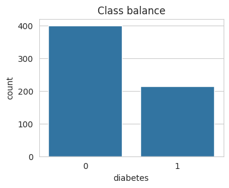
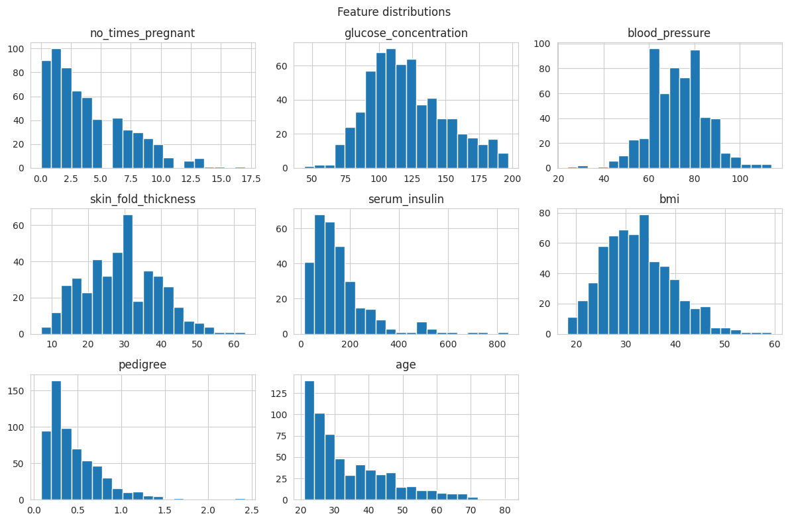
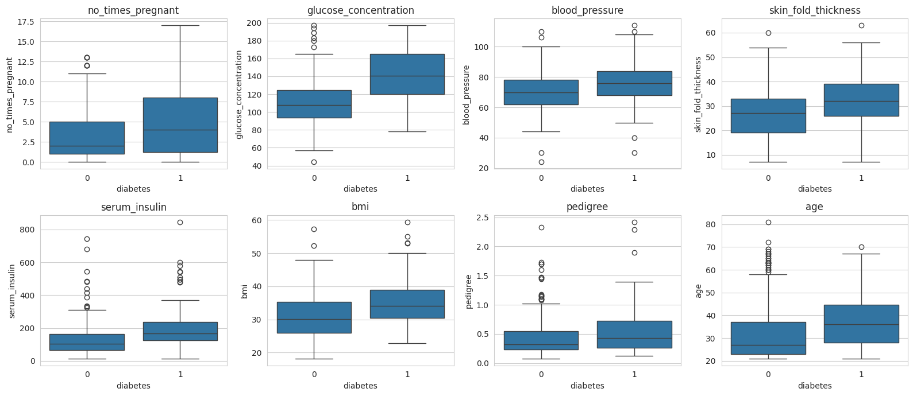
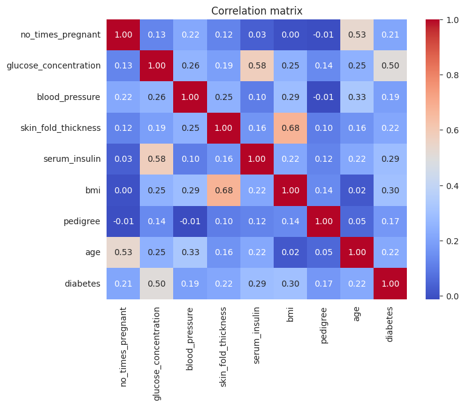
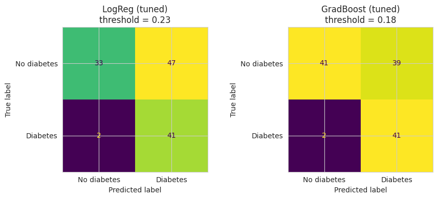
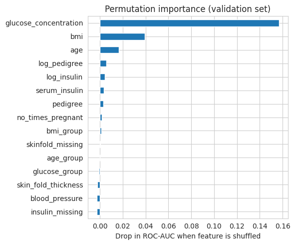

# Diabetes Prediction Using Machine Learning Classification

> **Disclaimer:** This is a learning project. The model is not a diagnostic tool and must not be used for medical decisions.

## 1. Project Overview

This project predicts whether a patient has diabetes from eight medical measurements. It compares a dummy baseline with Logistic Regression, Random Forest, and Gradient Boosting, tunes the two strongest models, and selects a decision threshold that catches most diabetic patients. The final model is Gradient Boosting, chosen by a small margin over Logistic Regression.

## 2. Problem Statement

The task is binary classification. The class of interest is diabetic (`diabetes` = 1). In a screening setting, a missed diabetic patient (false negative) is a worse error than a false alarm, because a follow-up test can confirm or clear a flagged patient. Recall for the diabetic class is therefore the main goal, while keeping false alarms as low as possible.

## 3. Objectives

- Clean the data, including hidden missing values stored as zeros.
- Explore the target balance, feature distributions, and relationships.
- Build leakage-safe pipelines with imputation and scaling.
- Compare models against a baseline using cross-validation.
- Tune the strongest models and compare them fairly.
- Choose a decision threshold that meets a recall target.
- Explain which features drive the final model.
- Generate predictions for the unlabeled test set.

## 4. Dataset Description

| File | Rows | Labels |
|---|---|---|
| `train.csv` | 614 | Yes |
| `test.csv` | 154 | No |

Each patient has eight measurements: number of pregnancies, glucose concentration, blood pressure, skin fold thickness, serum insulin, BMI, diabetes pedigree, and age. The target `diabetes` is 1 for diabetic and 0 otherwise. In the training set, 400 patients (65.1%) are non-diabetic and 214 (34.9%) are diabetic.

The source is not disclosed. See [`data/README.md`](data/README.md) for column descriptions and quality notes.

## 5. Tools and Technologies

| Tool | Use |
|---|---|
| Python | Main language |
| pandas, NumPy | Data handling |
| Matplotlib, seaborn | Visualisation |
| scikit-learn | Pipelines, models, cross-validation, tuning, metrics, permutation importance |
| Jupyter Notebook | Analysis and reporting |

## 6. Data Cleaning and Preparation

| Issue | Finding | Action |
|---|---|---|
| Column names | Target is `diabetes`; `diabetes pedigree` contains a space | Renamed to `pedigree` |
| Identifier | `p_id` | Dropped from model inputs, kept to label test predictions |
| Duplicates | None in train | None |
| Hidden missing values | Zeros in five columns where zero is impossible | Converted to NaN in both train and test |

Missing share in the training set after converting zeros:

| Column | Missing |
|---|---|
| `glucose_concentration` | 0.7% |
| `bmi` | 1.6% |
| `blood_pressure` | 5.0% |
| `skin_fold_thickness` | 30.5% |
| `serum_insulin` | 49.5% |

The same rule was applied to both files. It uses no information from the data, so it does not cause leakage. Imputation itself happens later inside the model pipeline.

## 7. Exploratory Data Analysis

1. **Moderate class imbalance.** About 2 to 1. A model that always predicts "no diabetes" scores 65.2% accuracy, so accuracy alone is misleading.
2. **Skew.** Insulin, pedigree, pregnancies, and age are right-skewed. Log transforms help Logistic Regression, while tree models do not need them.
3. **Glucose is the strongest signal.** Correlation with the target is 0.50, followed by BMI (0.30) and insulin (0.29). This matches medical knowledge.
4. **Correlated features.** Skin fold and BMI (0.68), and pregnancies and age (0.53). These are moderate, so all features were kept.
5. **Outliers.** Counts are small, except `pedigree` (26) and `serum_insulin` (20). They look like real patients, so they were kept.

**Class balance** (point 1)



**Feature distributions** (point 2: skew)



**Features by diabetes status** (points 3 and 5: glucose signal and outliers)



**Correlation matrix** (points 3 and 4)



## 8. Modelling Approach

**Feature engineering.** The data went from 8 to 15 features:

| Feature | Description |
|---|---|
| `insulin_missing`, `skinfold_missing` | Flags for missing values, created before imputation |
| `log_insulin`, `log_pedigree` | Log transforms for skewed columns |
| `age_group` | 21 to 30, 31 to 40, 41 to 50, 51 and above |
| `bmi_group` | Under 18.5, normal, overweight, obese |
| `glucose_group` | Under 100, 100 to 125, 126 and above (approximate, since the test is 2-hour glucose) |

**Split.** A stratified 80/20 split of the training file gave 491 training rows and 123 validation rows, both keeping the 65/35 class ratio. Cross-validation was used on the training part because 123 rows is too few for stable comparisons.

**Pipeline.** Each model sits inside a pipeline with median imputation and standard scaling. Inside cross-validation, the imputer and scaler are refit on each fold's training part, which prevents leakage.

**Metrics.** Accuracy cannot separate the models, so the project uses recall, F1, ROC-AUC, and specificity at a fixed recall. ROC-AUC was the tuning score because it does not depend on a threshold.

## 9. Model Comparison and Tuning

**Baseline and model comparison** (5-fold stratified CV, training set only)

| Model | Accuracy | Precision | Recall | F1 | ROC-AUC |
|---|---|---|---|---|---|
| LogReg balanced | 0.754 | 0.625 | 0.743 | 0.677 | 0.837 |
| LogReg | 0.752 | 0.685 | 0.538 | 0.600 | 0.836 |
| GradientBoosting | 0.754 | 0.664 | 0.597 | 0.627 | 0.832 |
| RandomForest balanced | 0.752 | 0.670 | 0.567 | 0.613 | 0.819 |
| RandomForest | 0.756 | 0.682 | 0.568 | 0.618 | 0.818 |
| Dummy (baseline) | 0.652 | 0.000 | 0.000 | 0.000 | 0.500 |

- Every model beats the baseline by about 10 points of accuracy, but accuracy is flat across models (0.752 to 0.756).
- Class weights help Logistic Regression a lot (recall 0.538 to 0.743) but do nothing for Random Forest.
- ROC-AUC gaps are small and within noise at this sample size.

**Tuning.** Logistic Regression (balanced) and Gradient Boosting were tuned with `GridSearchCV` on ROC-AUC. Random Forest was dropped because it was not better and class weights had no effect.

| Model | Best parameters | CV ROC-AUC |
|---|---|---|
| Logistic Regression | `C=0.1`, `penalty='l2'` | 0.840 |
| Gradient Boosting | `learning_rate=0.03`, `max_depth=2`, `n_estimators=200`, `subsample=0.7` | 0.840 |

Both models tied. The tuned Gradient Boosting settings are shallow and slow, which fits the finding that the signal is mostly linear.

## 10. Threshold Selection

**Attempt 1: maximise F2.** Thresholds were picked on out-of-fold training predictions, then scored once on the validation set.

| Model | Threshold | Accuracy | Precision | Recall | F1 |
|---|---|---|---|---|---|
| LogReg (tuned) | 0.5 | 0.699 | 0.550 | 0.767 | 0.641 |
| LogReg (tuned) | 0.23 (chosen) | 0.602 | 0.466 | 0.953 | 0.626 |
| GradBoost (tuned) | 0.5 | 0.789 | 0.707 | 0.674 | 0.690 |
| GradBoost (tuned) | 0.18 (chosen) | 0.667 | 0.512 | 0.953 | 0.667 |

*Confusion matrices at the F2-chosen thresholds (0.23 and 0.18). Both models flag most healthy patients.*



This failed in practice. Recall reached 0.953, but the models flagged most patients, and Logistic Regression accuracy (0.602) fell below the baseline (0.65). F2 weights a miss four times as heavily as a false alarm, which rewards flagging almost everyone when 35% of patients are positive. Logistic Regression was also corrected twice, once by `class_weight='balanced'` and once by the lower threshold.

**Attempt 2: a recall target.** The rule was changed to "the highest threshold that still reaches a target recall", again using out-of-fold training predictions only. The change was made after seeing the F2 validation results, although the validation rows were not used to tune the new rule.

Out-of-fold trade-off (training data):

| Threshold | LogReg recall | LogReg specificity | GradBoost recall | GradBoost specificity |
|---|---|---|---|---|
| 0.2 | 0.994 | 0.381 | 0.895 | 0.603 |
| 0.3 | 0.936 | 0.528 | 0.795 | 0.725 |
| 0.4 | 0.848 | 0.672 | 0.702 | 0.797 |
| 0.5 | 0.754 | 0.753 | 0.561 | 0.859 |
| 0.6 | 0.620 | 0.806 | 0.474 | 0.897 |

With an 85% recall target, validation recall was 0.814 for Logistic Regression (threshold 0.39) and 0.884 for Gradient Boosting (threshold 0.24). Precision was about 0.51 to 0.52, so roughly half of the flagged patients were healthy. At a ROC-AUC near 0.84, catching 85% of diabetic patients costs about a 40% false positive rate. No threshold can change this. Only better features or a better ranking would.

## 11. Final Model and Evaluation

**Choosing the model.** The two tuned models tied on CV ROC-AUC and trading places on the single validation split, so validation was no longer used to compare them. Both were compared with 5 x 5-fold repeated CV on all 614 labeled rows.

| Model | ROC-AUC | Specificity at 85% recall |
|---|---|---|
| Logistic Regression (tuned) | 0.836 +/- 0.003 | 0.640 +/- 0.017 |
| Gradient Boosting (tuned) | 0.839 +/- 0.004 | 0.686 +/- 0.023 |

ROC-AUC is a tie. Gradient Boosting leads on specificity at 85% recall by 0.046, about twice the standard deviation, so it was chosen. The standard deviations reflect split noise only, and the true uncertainty is larger. The cost is lower interpretability, which permutation importance partly offsets.

**Final threshold.** The final operating point targets 80% recall, which reduces false alarms compared with 85%. The threshold was picked on out-of-fold predictions over all 614 rows, repeated for five fold splits. The runs gave 0.29 to 0.30, and the median, 0.30, was used.

**Expected performance** (out-of-fold, average of 5 runs, threshold 0.30)

| Metric | Value |
|---|---|
| Recall | 0.803 |
| Precision | 0.622 |
| Specificity | 0.738 |
| Accuracy | 0.761 |
| Share flagged | 45.0% |

Confusion matrix (run 1): 297 true negatives, 103 false positives, 41 false negatives, 173 true positives.

**Test predictions.** The model was refit on all 614 rows. It flagged 49.4% of the 154 test patients as diabetic, a little above the 45% in cross-validation. With only 154 rows this is within normal variation, but it could also mean the test group has slightly higher glucose.

## 12. Key Findings

1. **Glucose dominates.** Permutation importance (drop in ROC-AUC when shuffled): glucose 0.157, BMI 0.039, age 0.017. This matches the EDA correlations and medical knowledge, and nothing points to leakage.
2. **Most other features add little.** `pedigree`, insulin, and pregnancies sit near zero. A few engineered features are slightly negative (`skin_fold_thickness`, `blood_pressure`, `insulin_missing`, `glucose_group`), meaning shuffling them did not hurt. These values come from 123 rows, so small differences are noise.
3. **The data limits the result.** ROC-AUC is about 0.84 for every reasonable model. Better thresholds only move along the same recall and false alarm trade-off.
4. **Simple models are competitive.** Logistic Regression matched Gradient Boosting on ROC-AUC. This is common on small tabular data with a mostly linear signal.
5. **Accuracy hides the trade-off.** Accuracy was 0.65 to 0.76 across nearly all settings, while recall ranged from 0.47 to 0.99.

Importance shows what the model uses, not what causes diabetes. Correlated features share credit, which is why `glucose_group` scores near zero.



### Answer to the problem

| Question | Answer |
|---|---|
| Can diabetes be predicted from the eight measurements? | **Partly.** The final model ranks patients well (ROC-AUC about 0.84) and beats the 65% baseline on accuracy (0.761 vs 0.652). It is a useful screening aid, not a reliable diagnosis. |
| Does it catch most diabetic patients? | **About 4 in 5.** At the final threshold (0.30), recall is 0.803, so about 1 in 5 diabetic patients is missed. |
| What is the cost of catching them? | **Many false alarms.** Precision is 0.622 and specificity is 0.738, so about 1 in 4 healthy patients is flagged. This suits screening only if a follow-up test is cheap. |
| Which features matter most? | **Glucose, then BMI and age.** Permutation importance (drop in ROC-AUC): glucose 0.157, BMI 0.039, age 0.017. |
| Which model is best? | **Gradient Boosting, by a small margin.** It ties Logistic Regression on ROC-AUC and leads on specificity at 85% recall (0.686 vs 0.640). |
| Is it ready for real use? | **No.** It is a learning project on 614 labeled rows. The test set has no labels, so test performance is unknown. |


## 13. Selected Visualisations

The figures appear in the sections where they are discussed. The full set of 6 is in [`figures/`](figures/).

| Figure | Shown in |
|---|---|
| `00-class-balance.png` | [7. Exploratory Data Analysis](#7-exploratory-data-analysis) |
| `01-feature-distributions.png` | [7. Exploratory Data Analysis](#7-exploratory-data-analysis) |
| `02-feature-boxplots-by-diabetes.png` | [7. Exploratory Data Analysis](#7-exploratory-data-analysis) |
| `03-correlation-matrix.png` | [7. Exploratory Data Analysis](#7-exploratory-data-analysis) |
| `04-confusion-matrices-f2-threshold.png` | [10. Threshold Selection](#10-threshold-selection) |
| `05-permutation-importance.png` | [12. Key Findings](#12-key-findings) |

## 14. Conclusion

Gradient Boosting with a 0.30 threshold is the final model. It is expected to catch about 80% of diabetic patients, with a precision of 0.62 and a specificity of 0.74, based on cross-validation. It beats the 65% baseline on accuracy, but its main strength is recall, which suits a screening setting with a follow-up test. The two tuned models were close, so the choice reflects a small margin rather than a clear win.

## 15. Limitations and Future Improvements

**Limitations**

1. The dataset is small (614 labeled rows), so model differences are small and may not hold on new data.
2. Insulin (49.5%) and skin fold thickness (30.5%) were mostly missing and imputed with the median.
3. The recall target is a project choice. About 1 in 5 diabetic patients is missed, and about 1 in 4 healthy patients is flagged by mistake. A real clinic would set the target from the cost of a follow-up test.
4. The threshold rule changed from F2 to a recall target after seeing the F2 validation results. The validation set was not used to tune the new rule, but the change should be stated.
5. The test set has no labels, so test performance is unknown.
6. Feature importance does not show causes, and probability calibration was not checked.

**Future improvements**

1. Drop weak features and compare with repeated CV.
2. Try better imputation, such as KNN or iterative imputation.
3. Check probability calibration if probabilities will be used as risk scores.
4. Collect more data or add features such as family history or HbA1c.
5. Compare test feature means with the training data to explain the 49.4% flagged share.

## 16. Project Structure

```
diabetes-prediction/
├── README.md
├── diabetes-prediction.ipynb
├── figures/
│   ├── 00-class-balance.png
│   ├── 01-feature-distributions.png
│   ├── 02-feature-boxplots-by-diabetes.png
│   ├── 03-correlation-matrix.png
│   ├── 04-confusion-matrices-f2-threshold.png
│   └── 05-permutation-importance.png
└── data/
    ├── README.md
    ├── train.csv
    └── test.csv
```

## 17. How to Run

1. Clone the repository and go to the project folder:

   ```bash
   git clone https://github.com/<your-username>/data-analytics-projects.git
   cd data-analytics-projects/02-machine-learning/diabetes-prediction
   ```

2. Install the required packages:

   ```bash
   pip install numpy pandas matplotlib seaborn scikit-learn jupyter
   ```

3. Make sure `train.csv` and `test.csv` are in the `data/` folder (see [`data/README.md`](data/README.md)).

4. Check the paths in the notebook's setup cell:

   ```python
   path = "data/"
   train = pd.read_csv(path + "train.csv")
   test = pd.read_csv(path + "test.csv")
   ```

   The final cell also writes `predictions.csv` to the same path. Change this if you want the file elsewhere.

5. Open and run the notebook from top to bottom:

   ```bash
   jupyter notebook diabetes-prediction.ipynb
   ```

A fixed seed (`SEED = 42`) is used, so results should match those reported here.