# House Price Prediction Using Machine Learning Regression

## 1. Project Overview

This project predicts the sale price of homes in Iowa from 79 descriptive features. It cleans the data, explores what drives price, builds three new features, and compares five regression models. Ridge Regression on `log(SalePrice)` gave the lowest validation error, and its predictions were submitted to the Kaggle competition [Housing Prices Competition for Kaggle Learn Users](https://www.kaggle.com/competitions/home-data-for-ml-course). The Kaggle public score was **14,227.48** (lower is better).

## 2. Problem Statement

Given a house's size, quality, location, and age, predict its sale price. This is a regression problem. A reliable estimate helps buyers, sellers, and lenders judge whether a price is reasonable. The project also asks which features matter most and where the model makes its largest errors.

## 3. Objectives

- Clean the data, separating real gaps from "no such feature" values.
- Explore the target and the features most related to price.
- Engineer features that combine related columns.
- Compare a baseline and four regression models on the same validation split.
- Evaluate with RMSE, MAE, and R² on the log scale.
- Study residuals and the largest errors.
- Generate and check predictions for the test set, then submit them to Kaggle.

## 4. Dataset Description

The data comes from the Kaggle competition linked above.

| File | Rows | Columns | Target |
|---|---|---|---|
| `train.csv` | 1,460 | 81 | `SalePrice` |
| `test.csv` | 1,459 | 80 | None |

Each row is one home sale. The 79 features cover the lot, building type, quality and condition, size and layout, basement, garage, extras such as pools and fireplaces, and the sale itself. 35 columns are integer, 3 are float, and 43 are text.

The files are not included in this repository. See [`data/README.md`](data/README.md) for download steps, column groups, and quality notes.

## 5. Tools and Technologies

| Tool | Use |
|---|---|
| Python | Main language |
| pandas, NumPy | Data handling |
| Matplotlib, seaborn | Visualisation |
| scikit-learn | Models, pipelines, scaling, metrics |
| Jupyter Notebook | Analysis and reporting |

## 6. Data Cleaning and Preparation

| Issue | Finding | Action |
|---|---|---|
| Duplicates | No duplicate rows or `Id` values | None |
| `MSSubClass` | A building type code, not a quantity | Converted to text |
| Missing means "no feature" (text) | No pool, alley, fence, garage, basement, and so on | Filled with `None` |
| Missing means "no feature" (numbers) | No veneer, basement, or garage | Filled with 0 |
| `GarageYrBlt` | Missing when there is no garage | Filled with `YearBuilt` |
| True gaps | `LotFrontage`, `Electrical`, and a few test columns | Most common value (text) or median (numbers), taken from train |
| Outliers | Two houses with very large living area and low price | Removed from train only |

Most missing values are not real gaps. For example, 81 houses have no garage, so every garage column shows 81 missing values. `MasVnrType` shows 872 missing values because pandas reads the text "None" as empty. All fill values come from the training data, and neither file has missing values afterwards.

**Outliers.** `Id` 524 (4,676 sq ft, sold for 184,750) and `Id` 1299 (5,642 sq ft, sold for 160,000) are far below the trend, so they were removed from train (1,460 to 1,458 rows). No rows were removed from test, because Kaggle needs a prediction for every `Id`.

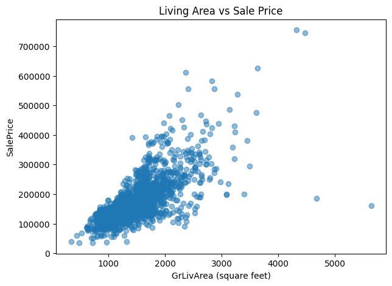

**Fixes in the test set.** Two test houses had impossible values:

- `Id` 2550 was sold in 2007 but built in 2008 (`SaleType` is `New`), giving a `HouseAge` of -1. It was set to 0.
- `Id` 2593 has a `GarageYrBlt` of 2207, most likely a typing error. It was replaced with the year the house was built (2006).

## 7. Exploratory Data Analysis

**The target is right-skewed.** `SalePrice` ranges from 34,900 to 755,000, with a mean (about 180,921) above the median (163,000). The skewness is 1.88. After a log transform it is 0.12, close to symmetric. The project therefore models `log(SalePrice)`.

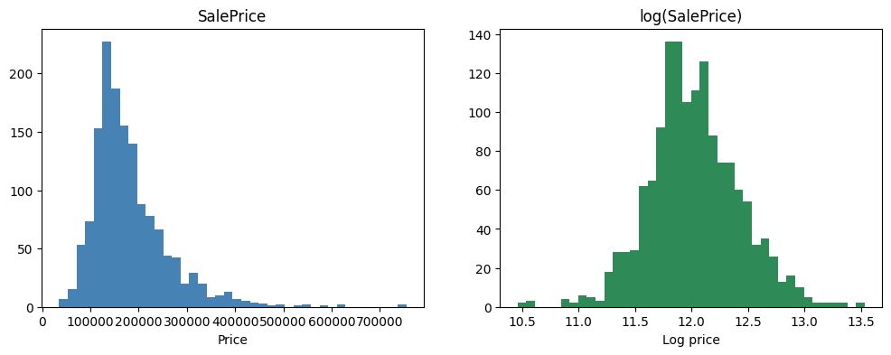

**Correlations.** `OverallQual` has the strongest link to price (0.80), followed by `GrLivArea` (0.73). `TotalBsmtSF`, `GarageCars`, `1stFlrSF`, and `GarageArea` are all between 0.63 and 0.65. Several features overlap: `GarageCars` and `GarageArea` (0.89), `YearBuilt` and `GarageYrBlt` (0.84), `GrLivArea` and `TotRmsAbvGrd` (0.83), and `TotalBsmtSF` and `1stFlrSF` (0.80). Overlap can make Linear Regression coefficients unstable, which is one reason Ridge was tried.

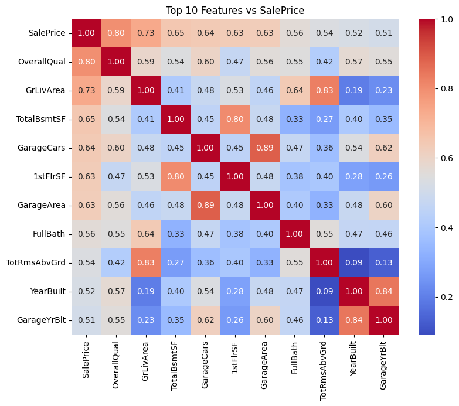

**Size and age.** `GrLivArea` and `TotalBsmtSF` show a clear upward, roughly straight trend, with wider spread for larger houses. `YearBuilt` has a weaker link: prices stay flat for older houses and rise for houses built after about 1980. About 37 houses have no basement (`TotalBsmtSF` of 0) and sit on the left edge of the plot.

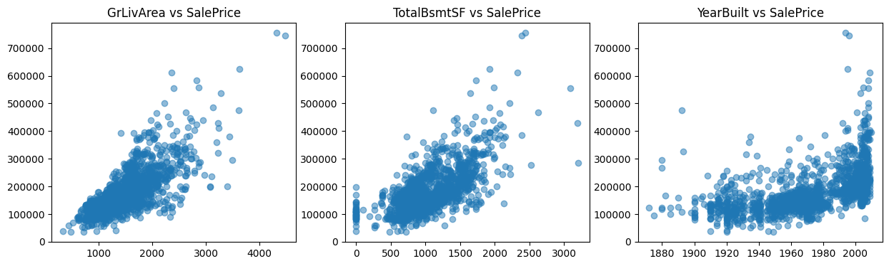

**Quality.** Median price rises at every step of `OverallQual`. The median at quality 10 is roughly 9 times higher than at quality 1 to 2.

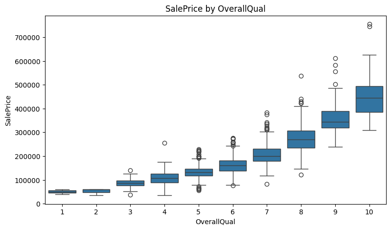

**Neighbourhood.** `NridgHt`, `NoRidge`, and `StoneBr` have the highest medians (about 280,000 to 315,000). `MeadowV`, `IDOTRR`, and `BrDale` have the lowest (about 90,000 to 105,000), roughly three times lower. Some neighbourhoods, such as `StoneBr` and `NoRidge`, have a wide spread, so neighbourhood alone does not fix the price.

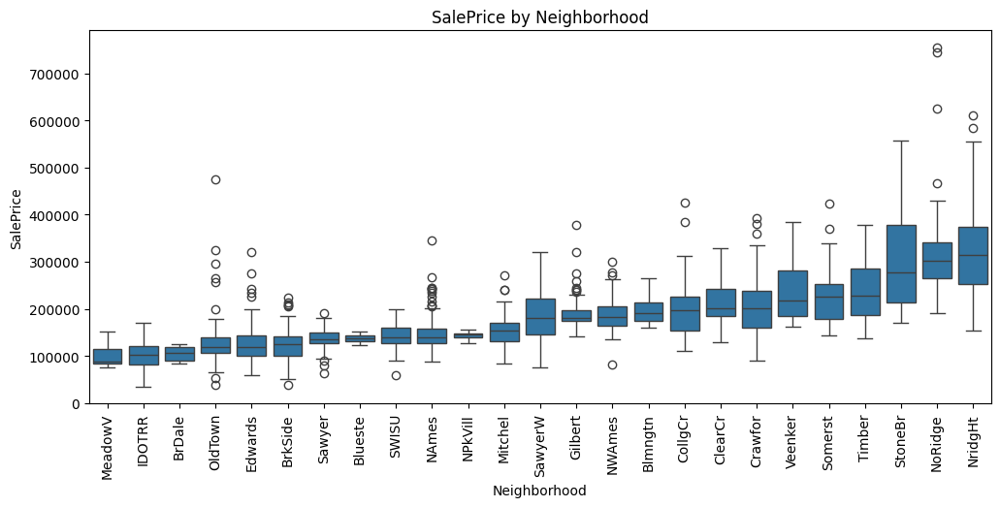

**Kitchen quality.** Average price rises with kitchen quality: about 105,000 for Fa, 140,000 for TA, 210,000 for Gd, and 330,000 for Ex. These values are read from the chart, so they are approximate.

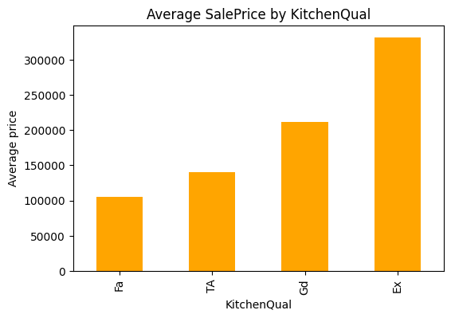

Correlation does not prove cause. A high quality score goes with a high price, but this analysis cannot show that it makes the price rise.

## 8. Feature Engineering

Three features were built for both train and test.

| Feature | Definition | Correlation with `SalePrice` |
|---|---|---|
| `TotalSF` | `TotalBsmtSF` + `1stFlrSF` + `2ndFlrSF` | 0.83 |
| `HouseAge` | `YrSold` - `YearBuilt` | -0.52 |
| `TotalBath` | `FullBath` + 0.5 x `HalfBath` + `BsmtFullBath` + 0.5 x `BsmtHalfBath` | 0.64 |

- `TotalSF` (0.83) has a stronger link to price than every original numeric feature, including `OverallQual` (0.80) and `GrLivArea` (0.73).
- `HouseAge` is negative, as expected: older houses tend to sell for less. It carries almost the same information as `YearBuilt` (0.52).
- `TotalBath` (0.64) is higher than `FullBath` alone (0.56), so combining the bath columns helped.
- One house near 6,400 sq ft sold for about 430,000, well below the trend. It was kept, because removing more rows can hurt results on new data.

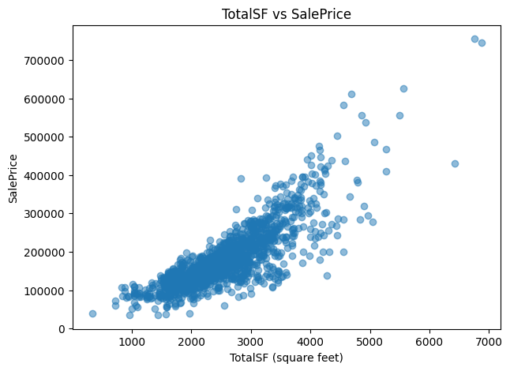

## 9. Modelling Approach

**Target.** The models predict `log(SalePrice)`, which removes most of the skew. Predictions are converted back to dollars with `exp`.

**Preparation**

- `Id` was dropped from the features and kept to label the Kaggle file.
- Text columns were one-hot encoded with `drop_first=True`, giving 274 columns.
- Test columns were matched to the train columns (same names, same order), which keeps test information out of the process.
- The training file was split 80/20 (`random_state=42`) into 1,166 training rows and 292 validation rows. The mean log price is 12.0234 in the training part and 12.0266 in the validation part, so the split is balanced.

**Models**

| Model | Notes |
|---|---|
| Baseline | Always predicts the mean log price of the training part |
| Linear Regression | The main reference model |
| Ridge Regression | `StandardScaler` and `RidgeCV` in one pipeline, alphas 1 to 1,000. Chosen alpha: 300 |
| Decision Tree | `max_depth=6` |
| Random Forest | 100 trees |

Ridge needs scaling because the penalty treats all columns equally. The pipeline fits the scaler on the training part only, and `RidgeCV` picks alpha inside the training part, so the validation part stays untouched. The chosen alpha of 300 sits in the middle of the tested range, which suggests that a fairly strong penalty was useful with so many overlapping features.

## 10. Model Evaluation

All models were scored on the same 292 validation houses, on the log scale.

| Model | RMSE (log) | MAE (log) | R² |
|---|---|---|---|
| Ridge | 0.1367 | 0.0913 | 0.8891 |
| Linear Regression | 0.1411 | 0.0940 | 0.8819 |
| Random Forest | 0.1469 | 0.0986 | 0.8720 |
| Decision Tree | 0.1969 | 0.1366 | 0.7701 |
| Baseline | 0.4106 | 0.3246 | -0.0001 |

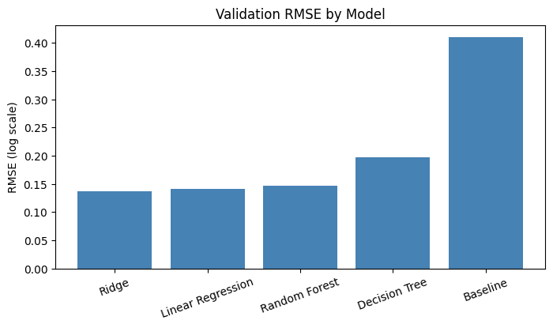

- **RMSE** measures the size of errors and penalises large ones. On the log scale, 0.12 corresponds roughly to a 12% multiplicative error. **MAE** is the average absolute error. **R²** is the share of variation in log price explained (1 is perfect, 0 equals the baseline).
- The baseline R² is about 0, as expected. All four trained models beat it. Ridge cuts RMSE by about 67% (0.4106 to 0.1367) and explains about 89% of the variation in log price.
- The Decision Tree is clearly the weakest trained model.
- **The top three are close.** Linear Regression (0.1411) did not perform much worse than Ridge despite 274 columns, so overfitting is modest. Ridge scored lowest on this validation split, but this does not prove it is better than the other two. The ranking could change on a different split.

## 11. Error Analysis

RMSE can hide patterns, so Ridge's predictions were studied on the validation set. A residual is actual minus predicted on the log scale. A negative residual means the model overestimated the price.

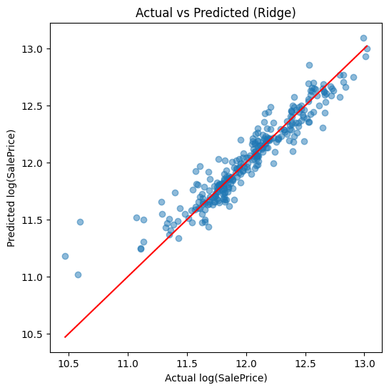

Points follow the reference line closely across most of the range. The visible exceptions are a few low-priced houses, which the model predicts too high.

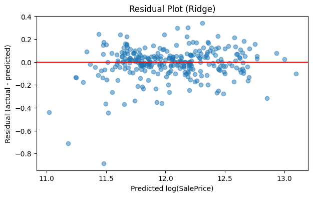

Residuals form a fairly random cloud around 0 with no clear curve or funnel. The largest negative residuals appear at low predicted prices.

**Bias.** The average residual is -0.0118, with 148 overestimates and 144 underestimates, so there is no strong lean in one direction.

**Largest errors.** All five are overestimates of low-priced houses.

| `Id` | Actual price | Predicted price | Residual (log) |
|---|---|---|---|
| 31 | 40,000 | 96,927 | -0.885 |
| 917 | 35,311 | 71,847 | -0.710 |
| 1433 | 64,500 | 100,460 | -0.443 |
| 534 | 39,300 | 61,068 | -0.441 |
| 590 | 79,500 | 115,257 | -0.371 |

These houses sit in lower-priced neighbourhoods (`IDOTRR`, `BrkSide`, `OldTown`) and have low quality scores. `Id` 31 and 917 are zoned `C (all)`, a category with only 10 houses (mean price 74,528), so the model has few examples to learn from. `Id` 917 was also an abnormal sale, and `Id` 534 is a tiny house (`TotalSF` 334, quality 1). That rare categories explain these errors has not been confirmed.

**Dollar error.** For context, Ridge's validation RMSE in dollars is 22,679.86.

## 12. Final Model and Kaggle Submission

Ridge was refit on all 1,458 training rows (alpha 300 again) and used to predict the 1,459 test houses. Predictions were checked before saving:

| Check | Result |
|---|---|
| Number of predictions | 1,459 |
| Minimum, mean | 51,608.80 and 176,760.50 |
| Maximum | 1,509,892.93 |
| Missing or negative values | None |

**One extreme prediction.** One house was predicted above 600,000: `Id` 2550, in `Edwards`, with quality 10, a `TotalSF` of 10,190 (`1stFlrSF`, `GrLivArea`, and `TotalBsmtSF` are all 5,095), a lot of 39,290 sq ft, and `SaleType` `New`. It is far larger than any house in train (maximum `TotalSF` 6,872, `GrLivArea` 4,476, `TotalBsmtSF` 3,206). This is also the house with the negative `HouseAge`, so its record looks unreliable. Its prediction was capped at the highest train price (755,000). Its true sale price is unknown.

The submission file contains `Id` and `SalePrice` for all 1,459 rows. The Kaggle public score was **14,227.48** (lower is better).

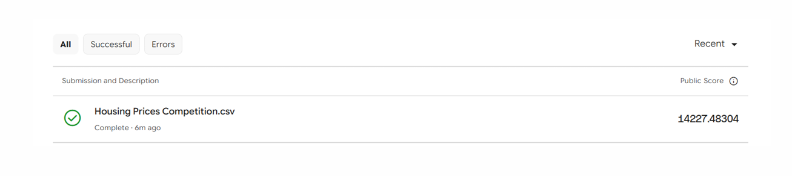

## 13. Key Findings

1. `SalePrice` is right-skewed (1.88). A log transform brings the skew to 0.12, so the models predict `log(SalePrice)`.
2. `OverallQual` (0.80) and `GrLivArea` (0.73) have the strongest correlations with price among the original features.
3. The engineered `TotalSF` has a correlation of 0.83, higher than any original numeric feature.
4. Median price differs clearly by neighbourhood, by about three times between the lowest and highest.
5. Ridge scored lowest on the validation set: RMSE 0.1367, MAE 0.0913, and R² 0.8891, against a baseline RMSE of 0.4106.
6. Ridge shows no strong overall bias (average residual -0.0118).
7. The largest errors are overestimates of low-priced houses, two of them in the rare `C (all)` zone.

## 14. Conclusion

Ridge Regression on `log(SalePrice)`, using three engineered features, reached the lowest validation RMSE (0.1367) and clearly outperformed the baseline. Linear Regression and Random Forest were close behind, so the choice of Ridge is a small edge on one validation split, not a proven win. The Kaggle public score was 14,227.48.

## 15. Limitations and Future Improvements

**Limitations**

1. Models were compared on a single validation split of 292 houses, and the top three performed similarly.
2. Ridge overestimated very low-priced houses. Rare categories such as `C (all)` give few training examples, although this has not been confirmed as the cause.
3. Two outlier houses were removed from train. One test house (`Id` 2550) had an unreliable record, and its prediction was capped at 755,000. Its true price is unknown.
4. One impossible `GarageYrBlt` (`Id` 2593) and one negative `HouseAge` (`Id` 2550) in test were fixed with simple rules.
5. Correlation does not prove causation.

**Future improvements**

1. Group rare categories to improve estimates for under-represented groups.
2. Use cross-validation for a more reliable model comparison.
3. Try a more advanced model, such as gradient boosting, if the task allows it.

## 16. Project Structure

```
house-price-prediction/
├── README.md
├── house-price-prediction.ipynb
├── figures/
│   ├── 00-living-area-vs-sale-price-outliers.png
│   ├── 01-sale-price-vs-log-sale-price.png
│   ├── 02-top-features-correlation-heatmap.png
│   ├── 03-key-feature-scatter-plots.png
│   ├── 04-sale-price-by-overall-quality.png
│   ├── 05-sale-price-by-neighborhood.png
│   ├── 06-sale-price-by-kitchen-quality.png
│   ├── 07-total-sf-vs-sale-price.png
│   ├── 08-validation-rmse-by-model.png
│   ├── 09-actual-vs-predicted-ridge.png
│   ├── 10-residual-plot-ridge.png
│   └── 11-kaggle-public-score.png
└── data/
    └── README.md
```

`train.csv`, `test.csv`, and the generated `submission.csv` are not committed.

## 17. How to Run

1. Clone the repository and go to the project folder:

   ```bash
   git clone https://github.com/<your-username>/data-analytics-projects.git
   cd data-analytics-projects/02-machine-learning/house-price-prediction
   ```

2. Install the required packages:

   ```bash
   pip install numpy pandas matplotlib seaborn scikit-learn jupyter
   ```

3. Download `train.csv` and `test.csv` from the [Kaggle competition](https://www.kaggle.com/competitions/home-data-for-ml-course/data) and place them in the `data/` folder (see [`data/README.md`](data/README.md)).

4. Check the paths in the notebook's setup cell:

   ```python
   folder = "data/"
   train = pd.read_csv(folder + "train.csv")
   test = pd.read_csv(folder + "test.csv")
   ```

   The notebook saves `submission.csv` at the end. Remove the Colab download cells and save the file where you prefer.

5. Open and run the notebook from top to bottom:

   ```bash
   jupyter notebook house-price-prediction.ipynb
   ```

A fixed seed (`random_state=42`) is used for the split and the tree models, so results should match those reported here.