# Store Sales Forecasting Using Machine Learning

## 1. Project Overview

This project forecasts **total daily sales** for Corporación Favorita, a large grocery retailer in Ecuador. It explores five years of sales history, builds a clean daily series, and compares five simple forecasting models on a held-out 30-day period. Exponential Smoothing (Holt-Winters) gave the lowest error: a WAPE of 7.0%, which is about 58,000 units on an average of about 833,000 units per day. A simple Seasonal Naive model came within 3.8% of it.

The project forecasts total sales across all stores and product families. It does not forecast each store or product family, and it does not make a Kaggle submission.

## 2. Problem Statement

Accurate sales forecasts help a retailer plan stock, staff, and promotions. Poor forecasts lead to empty shelves or wasted products. The task is to forecast total daily sales 30 days ahead using only information that is known at forecast time, and to find out which simple model does this best.

## 3. Objectives

- Clean the data and build one regular daily series.
- Explore the trend, weekly and yearly patterns, promotions, and other signals.
- Split the data by time, so no future information reaches the models.
- Build a Naive baseline and four other models.
- Compare the models with MAE, RMSE, WAPE, and bias.
- Study where the best model fits and where it misses.
- State how strong the result is and what limits it.

## 4. Dataset Description

The data comes from the Kaggle competition [Store Sales - Time Series Forecasting](https://www.kaggle.com/competitions/store-sales-time-series-forecasting/data).

| File | Rows | Content |
|---|---|---|
| `train.csv` | 3,000,888 | Daily sales by store and product family, plus items on promotion |
| `stores.csv` | 54 | Store city, state, type, and cluster |
| `oil.csv` | 1,218 | Daily oil price (weekdays only) |
| `transactions.csv` | 83,488 | Daily transaction counts per store |
| `holidays_events.csv` | 350 | Holidays and events (loaded but not used) |

The history runs from 2013-01-01 to 2017-08-15 (1,684 dates), with 54 stores and 33 product families. The target is `sales`, summed across all stores and families for each day. The test file and the sample submission are not used.

The files are not included in this repository. See [`data/README.md`](data/README.md) for download steps, column descriptions, and quality notes.

## 5. Tools and Technologies

| Tool | Use |
|---|---|
| Python | Main language |
| pandas, NumPy | Data handling |
| Matplotlib, seaborn | Visualisation |
| scikit-learn | Linear Regression and error metrics |
| statsmodels | Exponential Smoothing (Holt-Winters) |
| Jupyter Notebook | Analysis and reporting |

## 6. Data Cleaning and Preparation

| Issue | Finding | Action |
|---|---|---|
| Missing values and duplicates | None in `train.csv` | None |
| Negative sales | None | None |
| Missing dates | 4 days, all December 25 (2013 to 2016), when stores are closed | Not filled with zero at this stage |
| Zero sales | 939,130 rows (31.3%). Many are product families that sell rarely, or stores that had not opened yet | Kept, since they are real "nothing sold" values |
| 2013-01-01 | Only 1 of 54 stores reported sales | Removed from the daily series |
| January 1 of other years | Low-sales days caused by the holiday | Kept |

Sales were then summed across all stores and families into one row per date, giving 1,683 days from 2013-01-02 to 2017-08-15. The original `train` table stays unchanged, and all changes go into the daily table.

**Regular calendar.** Lag-based models need one row per day, so a full daily calendar (1,687 rows) was built. The 4 closed December 25 dates were filled by linear interpolation between the neighbouring days and flagged with a `filled` column. The fill is rough, because real sales were zero on those days. Four days out of 1,687 have a small effect, and this is listed in the limitations.

## 7. Exploratory Data Analysis

### Trend

Average daily sales rose from about 387,000 units in 2013 to about 856,000 in 2017, roughly 2.2 times higher. 2017 has only 7.5 months of data, so the comparison uses average daily sales, not totals. The number of stores with sales rose from about 46 to 54 over the period, which explains part of the growth.

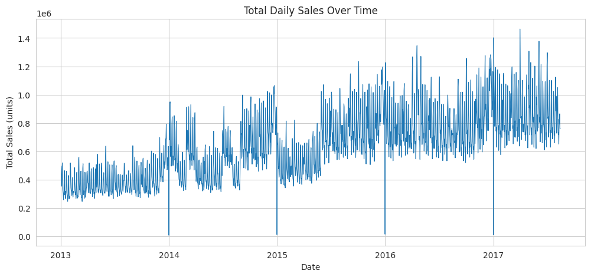

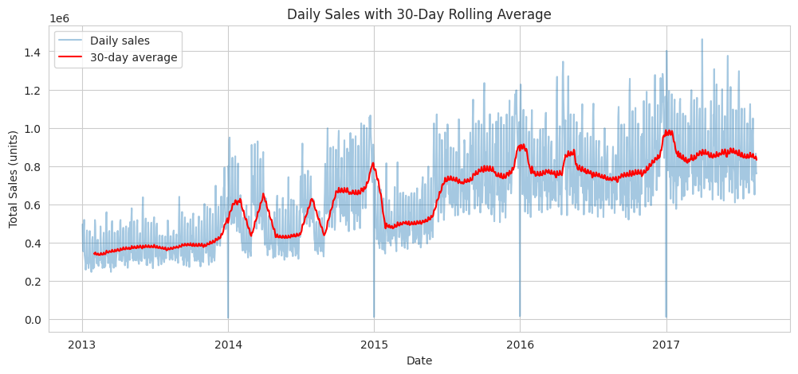

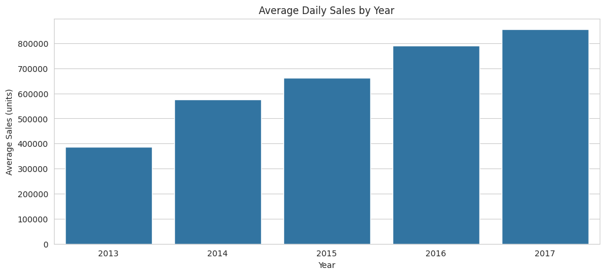

The level shifts during 2014 and early 2015 are larger than a smooth trend. Store coverage was checked as a cause and ruled out, but the cause was not found.

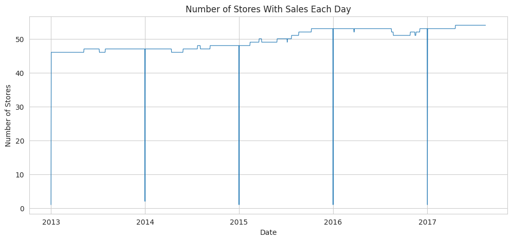

### Weekly pattern

The weekly pattern is strong. Sunday is the highest day (about 825,000) and Saturday is second (about 772,000). Thursday is the lowest (about 505,000). Sunday sells about 63% more than Thursday. The last 90 days, closest to the forecast period, show a stable level near 0.85 million units with a clear weekly cycle.

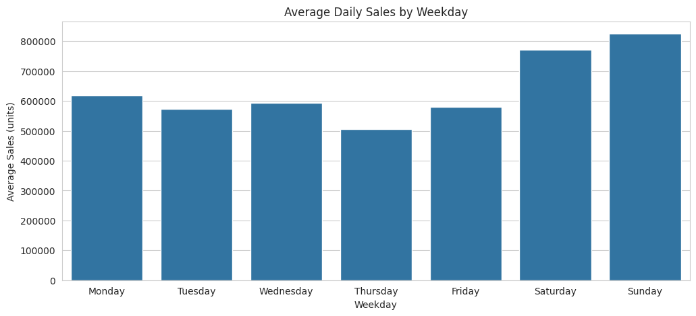

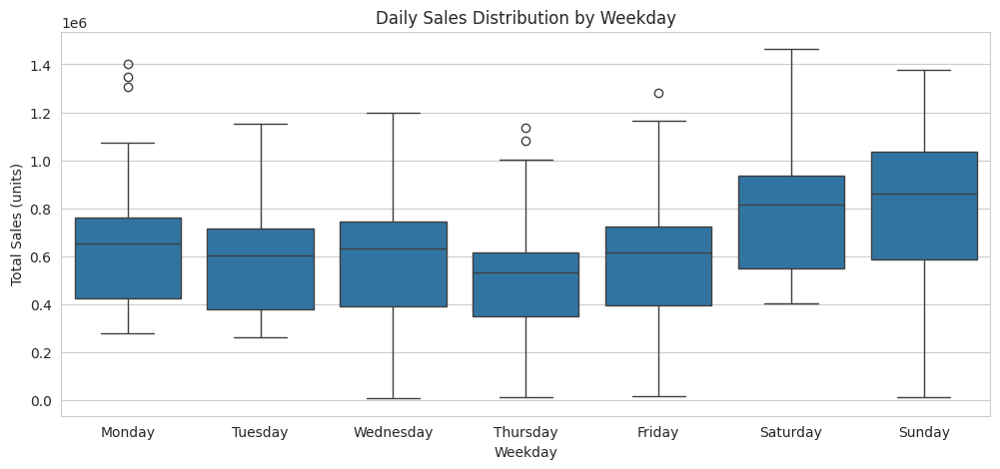

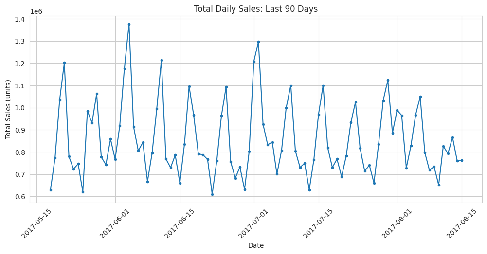

### Yearly pattern

December is the highest month, with about 810,000 units per day against 570,000 to 670,000 for other months. This mixes trend and season, because 2017 has no December data. January 1 is a near-zero day every year, visible as sharp drops in the line chart.

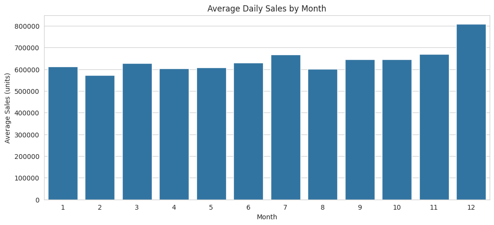

### Distributions

Daily sales are spread between about 0.3 and 1.4 million units, with a small group of near-zero days (the January 1 dates). At row level, 31% of store and family values are zero, so a log scale is used to see the shape.

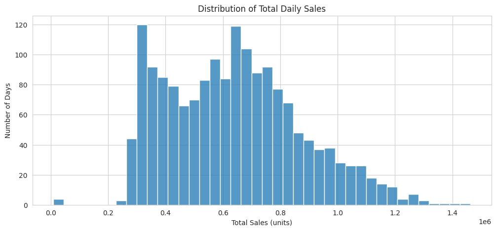

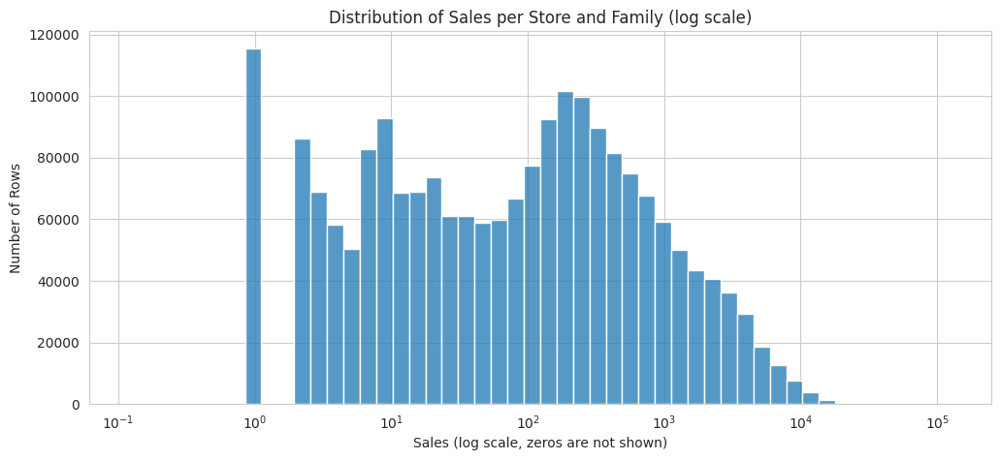

### Promotions

Promotions are recorded only from 2014-04-01. Before that date a value of 0 means "not recorded", not "no promotion", so only later days were compared. From that date, sales rise with promotion level: the average is about 575,000 in the Low group and about 837,000 in the High group, with a correlation of 0.43. Promotions and sales both grow over time, so this does not prove that promotions cause the increase.

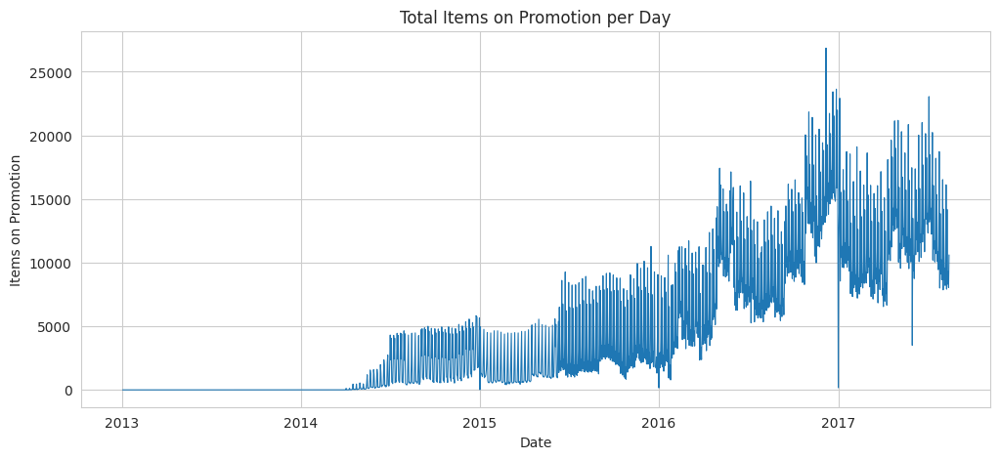

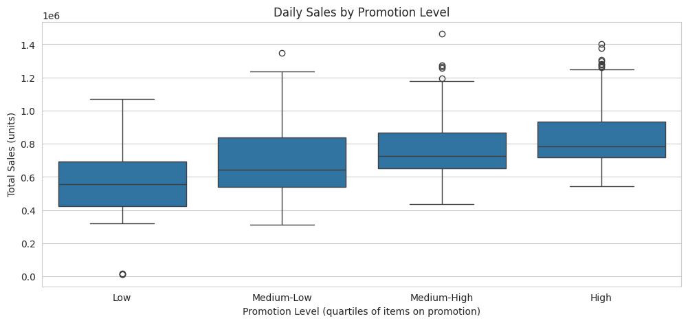

### Stores and product families

Stores 44, 45, 47, and 3 have the highest total sales. GROCERY I, BEVERAGES, and PRODUCE are the top three families, and store type A has the highest average sales per row. The project forecasts total sales, so these results explain the data but do not change the model.

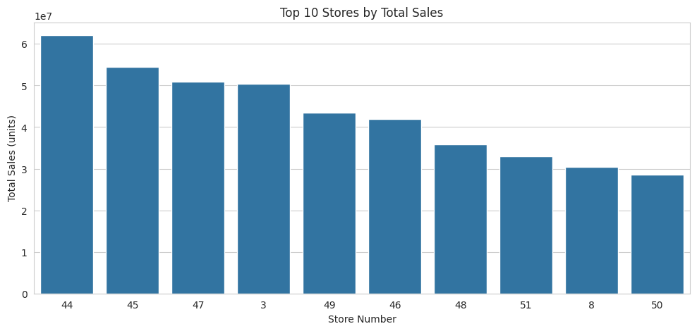

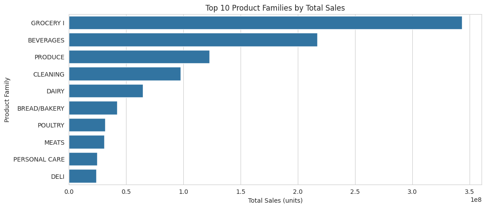

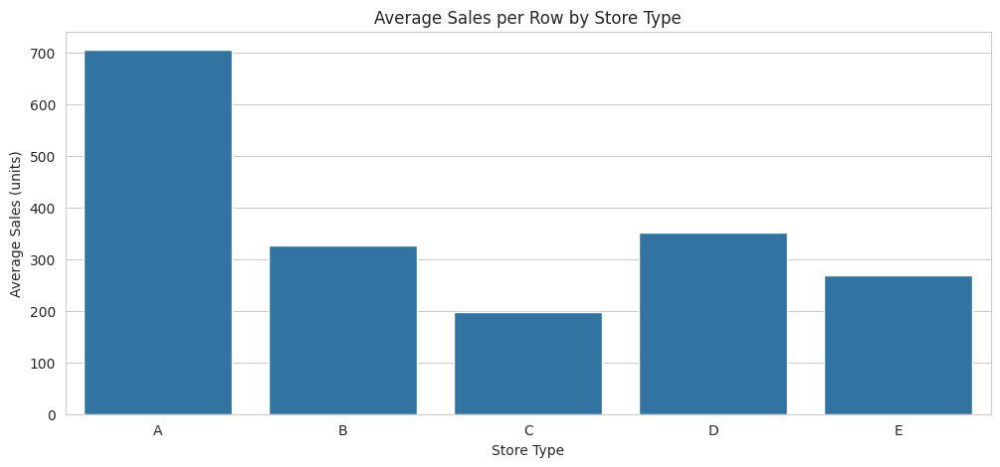

### Oil and transactions

Transactions move with sales (correlation 0.68), but future transactions are not known at forecast time, so they cannot be used. Oil price has a correlation of -0.63 with sales, but both series trend over time, and the scatter plot shows two clusters that match two time periods (high oil and low sales in 2013 and 2014, low oil and higher sales later). Oil is therefore not used. The first version of this check lost 481 weekend rows in the join, and the corrected version merges onto the daily calendar first and then fills.

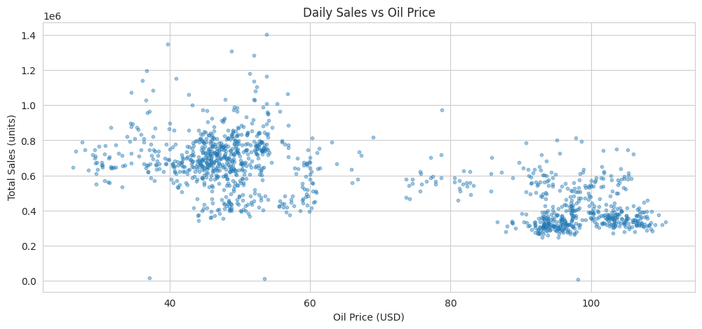

## 8. Forecasting Setup

| Item | Choice |
|---|---|
| Target | Total daily sales across all stores and product families |
| Horizon | 30 days |
| Features known in advance | `time_index`, `weekday`, `month`, all built from the date only |
| Training part | 2013-01-02 to 2017-07-16 (1,657 days) |
| Validation part | 2017-07-17 to 2017-08-15 (30 days) |

The split is by time, never random. A random split would let the model see future dates during training, and the results would look better than they are. All five models are scored on the same 30 days, and the check for overlap between the two parts returned False.

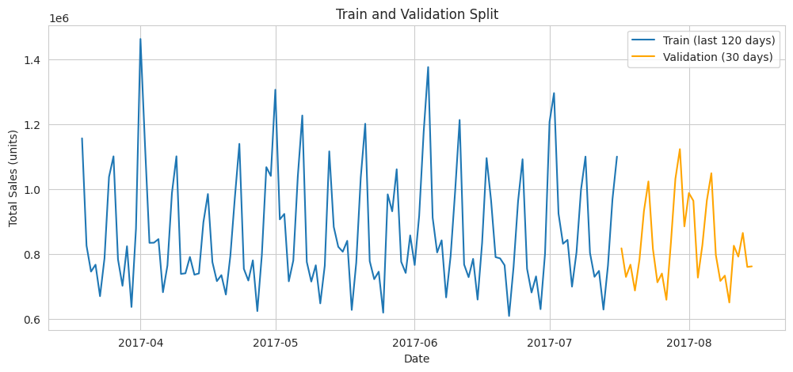

**Metrics** (lower is better)

| Metric | Meaning |
|---|---|
| MAE | The average miss, in units per day |
| RMSE | Like MAE, but large misses count more |
| WAPE | Total absolute error as a percentage of total actual sales |
| Bias | Average of (predicted minus actual). Positive means the forecast is too high |

The 30 validation days total 24,985,327 units, an average of 832,844 per day.

## 9. Models

| Model | How it forecasts |
|---|---|
| Naive | Repeats the last training value (1,100,804, a Sunday) for every day |
| Seasonal Naive | Repeats the last 7 training days, so each weekday copies the same weekday of the last week |
| Moving Average (7) | Forecasts the mean of the last 7 training days as one flat level |
| Linear Regression | Time index (trend) plus weekday dummies, trained on the last 365 days only |
| Exponential Smoothing | Holt-Winters with additive trend and a 7-day additive seasonal pattern, trained on the last 365 days |

- **Why the last 365 days?** The trend changed over the years, so older data would pull a straight line away from the current level.
- **Why no promotions?** Future promotions are not known at forecast time, so `onpromotion` was left out.
- **Alignment checks.** The last training week runs Monday to Sunday and the validation period starts on a Monday, so the Seasonal Naive weekdays line up. The Holt-Winters forecast starts on 2017-07-17, the day after training ends. No model produced a negative prediction.

The Naive baseline has an MAE of 269,489 and a WAPE of 32.4%. Its error is large because the last training day was a Sunday, the highest weekday, so the forecast sits too high almost every day. This makes Naive a weak baseline that depends on which weekday the training data ends. Seasonal Naive is the more meaningful baseline.

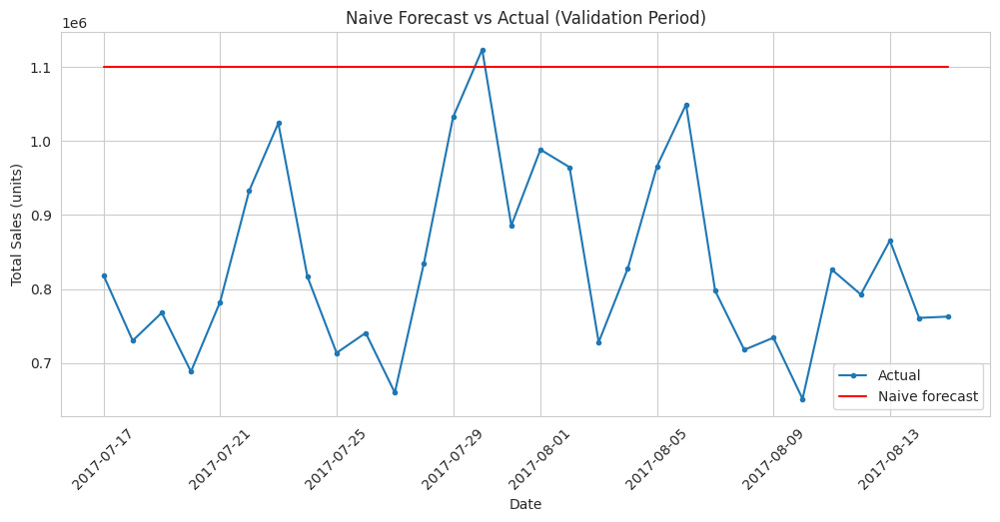

## 10. Model Evaluation

| Model | MAE | RMSE | WAPE (%) | Bias | MAE vs Naive |
|---|---|---|---|---|---|
| Exponential Smoothing | 58,380 | 88,832 | 7.0 | +6,055 | 78.3% lower |
| Seasonal Naive | 60,672 | 91,696 | 7.3 | -15,219 | 77.5% lower |
| Linear Regression | 92,052 | 112,111 | 11.1 | +73,844 | 65.8% lower |
| Moving Average (7) | 98,151 | 123,357 | 11.8 | -11,628 | 63.6% lower |
| Naive | 269,489 | 294,761 | 32.4 | +267,960 | baseline |

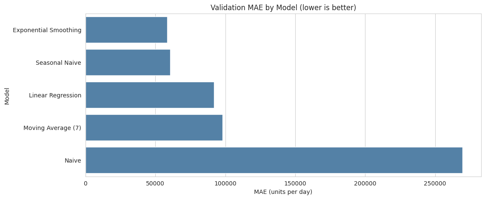

- All three error metrics give the same ranking, and every model beats the Naive baseline.
- Exponential Smoothing is best, but its MAE is only 3.8% lower than Seasonal Naive. With a 30-day window, this is a small gap that could change on another window.
- Linear Regression follows the weekly shape but forecasts too high (bias +73,844). Its weaker score comes from a level error, not a shape error.
- Moving Average is a flat line, so it cannot capture the weekly pattern.

## 11. Actual vs Predicted

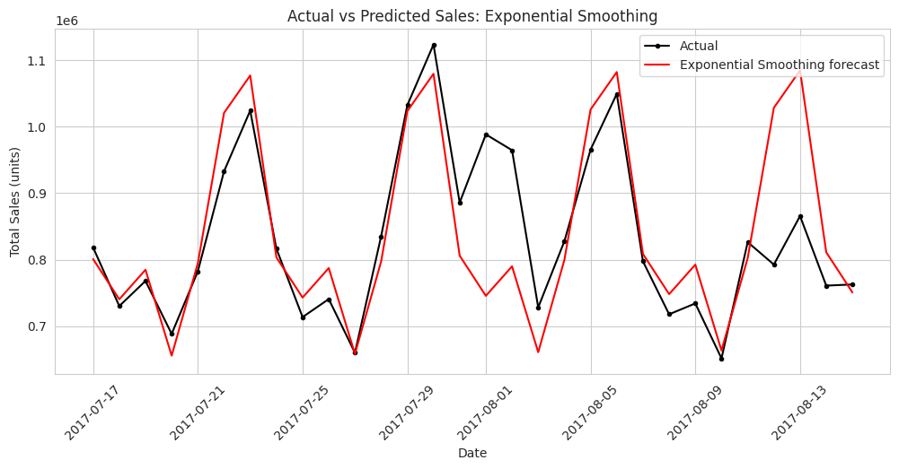

Exponential Smoothing rises on weekends and falls midweek, and its overall level is close to the actual line (bias +6,055 units per day). It misses the early August peak (2017-07-31 to 2017-08-02) and over-predicts the weekend of 2017-08-12 to 2017-08-13.

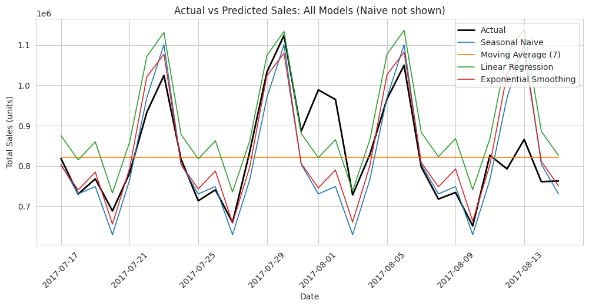

The Naive model is left out of this chart, because its flat line at 1.10 million would squash the scale.

## 12. Final Model Selection

**Selected model: Exponential Smoothing (Holt-Winters).** It has the lowest validation error on all three metrics (MAE 58,380, RMSE 88,832, WAPE 7.0%).

- It captures the weekly pattern with a 7-day seasonal component.
- It updates its level from recent data, so it matches the current sales level.
- It needs no future inputs, so it is realistic to use.

**How strong is the result?** It beats Naive by 78.3%, which is a clear win. It beats Seasonal Naive by only 3.8%, which is a small gap on a 30-day window, so it cannot be called clearly better. If simplicity matters more, Seasonal Naive is a reasonable alternative.

**Business meaning.** The best model misses by about 58,000 units on a typical day, which is 7.0% of the average of 832,844.

## 13. Key Findings

### Answer to the problem

| Question | Answer |
|---|---|
| Can total daily sales be forecast 30 days ahead? | **Yes.** The best model has a WAPE of 7.0%, meaning it misses by about 58,000 units on a typical day (average about 833,000). |
| Which model is best? | **Exponential Smoothing (Holt-Winters)**, but only by a small margin. Seasonal Naive is within 3.8%, so a simple weekly repeat is already strong for this series. |
| What drives the sales pattern? | **A strong upward trend, a weekly cycle, and a December peak.** Average daily sales rose about 2.2 times from 2013 to 2017, and Sunday sells about 63% more than Thursday. |
| Is it enough to plan stock, staff, and promotions? | **Partly.** It forecasts total sales only, so it cannot plan stock per store or product. It uses no holidays or promotions, and it is tested on one 30-day window (July and August 2017). |

### Supporting findings

1. Sales show a strong upward trend, with average daily sales of about 387,000 in 2013 and about 856,000 in 2017.
2. The weekly pattern is strong: Sunday is highest (about 825,000) and Thursday is lowest (about 505,000).
3. December is the highest month (about 810,000), and January 1 is a near-zero day every year.
4. Promotions are recorded only from 2014-04-01, and sales rise with promotion level (correlation 0.43), but this does not prove cause.
5. Transactions (0.68) and oil (-0.63) move with sales but cannot be used, because future transactions are unknown and oil trends over time like sales.
6. Exponential Smoothing has the lowest MAE, RMSE, and WAPE and a small bias (+6,055 units per day).
7. A simple Seasonal Naive model (MAE 60,672) is already strong, because the weekly pattern dominates the series.

## 14. Conclusion

Total daily sales can be forecast 30 days ahead with an average error of about 7%. Exponential Smoothing (Holt-Winters) was the best of five simple models, and every model beat the Naive baseline. The gap to Seasonal Naive is small, so the choice reflects a slim margin on one validation window. The forecasts are a useful starting point for planning at the total level, and the limits below should be addressed before using them for store-level decisions.

## 15. Limitations and Future Improvements

**Limitations**

1. **Scope.** The models forecast total sales only, not each store or product family, and no Kaggle submission was made.
2. **Short validation window.** 30 days is only 4 weeks. The gap between the top two models is small and could change on another window.
3. **No holidays or paydays.** The model misses the early August peak, which may relate to the turn of the month. This was not tested, and `holidays_events.csv` was not used.
4. **Promotions and oil not used.** Future promotions are unknown at forecast time, and oil trends over time in the same way as sales, so it is not a reliable signal.
5. **Unexplained level shifts.** The sales level jumped in 2014 and early 2015. Store coverage was ruled out, but the cause was not found.
6. **Filled Christmas days.** Four closed days were filled by interpolation, although real sales were zero.
7. **Linear Regression window.** Only the last 365 days were used, and other windows were not tested.
8. **One validation period.** Validation covers July and August only, so the models were not tested on December or January 1.

**Future improvements**

1. Add holiday and payday features.
2. Test several validation windows (rolling-origin evaluation).
3. Forecast by store or product family.
4. Try a shorter training window for Linear Regression.

## 16. Project Structure

```
store-sales-forecasting/
├── README.md
├── store-sales-forecasting.ipynb
├── figures/
│   ├── 00-total-daily-sales-over-time.png
│   ├── 01-daily-sales-30-day-rolling-average.png
│   ├── 02-daily-sales-last-90-days.png
│   ├── 03-average-sales-by-weekday.png
│   ├── 04-sales-distribution-by-weekday.png
│   ├── 05-average-sales-by-month.png
│   ├── 06-average-sales-by-year.png
│   ├── 07-daily-sales-distribution.png
│   ├── 08-row-level-sales-distribution.png
│   ├── 09-items-on-promotion-over-time.png
│   ├── 10-sales-by-promotion-level.png
│   ├── 11-top-10-stores-by-sales.png
│   ├── 12-top-10-product-families-by-sales.png
│   ├── 13-sales-by-store-type.png
│   ├── 14-sales-vs-oil-price.png
│   ├── 15-active-stores-per-day.png
│   ├── 16-train-validation-split.png
│   ├── 17-naive-forecast-vs-actual.png
│   ├── 18-validation-mae-by-model.png
│   ├── 19-actual-vs-predicted-exponential-smoothing.png
│   └── 20-actual-vs-predicted-all-models.png
└── data/
    └── README.md
```

The Kaggle data files are not committed.

## 17. How to Run

1. Clone the repository and go to the project folder:

   ```bash
   git clone https://github.com/<your-username>/data-analytics-projects.git
   cd data-analytics-projects/02-machine-learning/store-sales-forecasting
   ```

2. Install the required packages:

   ```bash
   pip install numpy pandas matplotlib seaborn scikit-learn statsmodels jupyter
   ```

3. Download the data from the [Kaggle competition](https://www.kaggle.com/competitions/store-sales-time-series-forecasting/data) and place the CSV files in the `data/` folder (see [`data/README.md`](data/README.md)). `train.csv` is large, so make sure there is enough memory (about 285 MB when loaded).

4. Check the path in the notebook's setup cell:

   ```python
   data_path = "data"
   ```

5. Open and run the notebook from top to bottom:

   ```bash
   jupyter notebook store-sales-forecasting.ipynb
   ```

The models have no random components, so results should match those reported here. Small differences are possible across library versions, mainly for Holt-Winters.