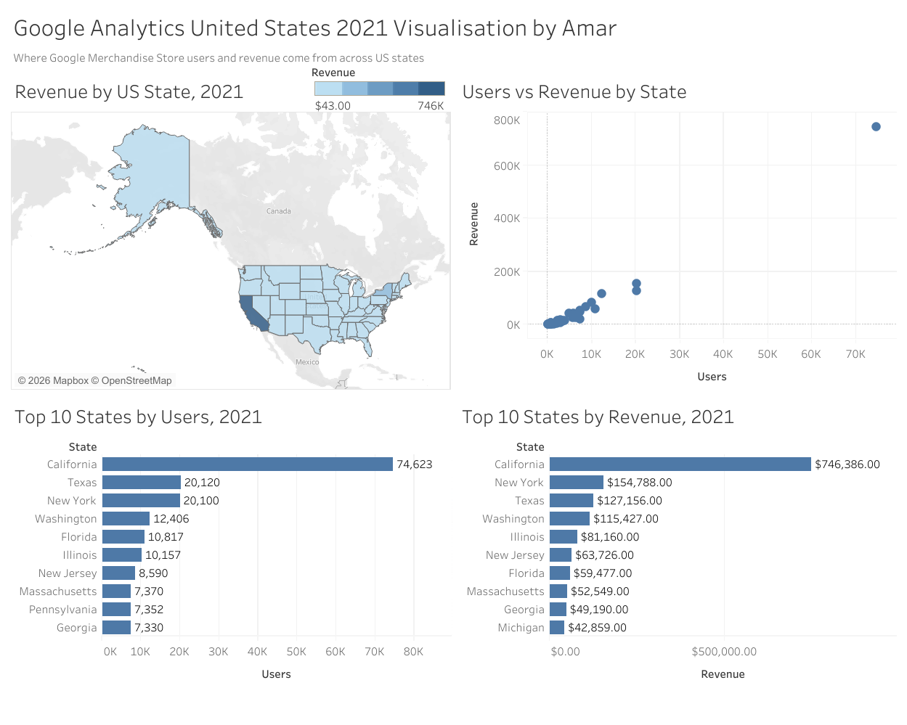

# Where the Revenue Comes From: US Location Analysis of the Google Merchandise Store (2021)

A Tableau dashboard analysing where Google Merchandise Store users and revenue come from across US states in 2021, built from a Google Analytics location report cleaned and prepared in Google Sheets.

**[View the live dashboard on Tableau Public](https://public.tableau.com/views/GoogleAnalyticsUS2021_17941114680870/GoogleAnalyticsUnitedStates2021VisualisationbyAmar?:language=en-US&:sid=&:redirect=auth&:display_count=n&:origin=viz_share_link)**



---

## Business context

An ecommerce team wants to know **which US states drive traffic and sales, and whether more visitors always means more revenue.** The answer helps decide where to focus marketing spend, which regions are under-performing, and which small markets are worth a closer look.

Questions this project answers:

1. Which states generate the most users and revenue?
2. How strongly are users and revenue related?
3. Which states earn more (or less) revenue than their traffic would suggest?

## Dataset

| Item | Detail |
|---|---|
| Source | Google Analytics demo account, Google Merchandise Store (web data) |
| Report | Location report, United States |
| Period | 1 January 2021 to 31 December 2021 |
| Granularity | One row per US state |
| Raw file | [`data/raw/Analytics_Master_View_Location_2021.csv`](data/raw/Analytics_Master_View_Location_2021.csv) (52 regions plus a totals row) |
| Clean file | [`data/processed/Google_Analytics_US_2021_Cleaned.csv`](data/processed/Google_Analytics_US_2021_Cleaned.csv) (51 rows: 50 states plus District of Columbia) |

**Columns used:** Users, New Users, Sessions, Bounce Rate, Pages per Session, Average Session Duration, Transactions, Revenue, Conversion Rate. See the [data dictionary](docs/data_dictionary.md).

> The Google Merchandise Store demo data is publicly available and is not real customer data.

## Tools

- **Google Sheets**: data preparation and cleaning (text functions, formatting, a logged list of actions)
- **Tableau Public**: visualisation and dashboard

## Process

### 1. Preparation
The CSV was imported into Google Sheets. The export's comment lines and blank rows at the top were removed, the header row was frozen and formatted, borders were added and columns were resized.

### 2. Data cleaning
Cleaning was done on a copy of the raw file, with every action recorded. The full list is in the [data cleaning log](docs/data_cleaning_log.md). In summary:

- Removed the **totals row** so it would not be counted as a region.
- Removed the **`(not set)`** row. This is traffic Google could not assign to a state (3,352 users, $11,760.68 revenue), so it cannot be mapped.
- Kept **District of Columbia**, so the clean file has **51 rows (50 states plus DC)**.
- Checked for **duplicates and missing values**: none found.
- Converted **Revenue** from text (`$746,386.06`) to a whole-dollar number (`746386`).
- Converted **Bounce Rate** and **Conversion Rate** from percentage text to decimals.
- Converted **Average Session Duration** from `hh:mm:ss` to seconds.
- Renamed columns for clarity (for example `Region` to `State`).
- **Validated** the result against the raw file. Users, New Users, Sessions and Transactions match exactly for all 51 states, and revenue differs only by rounding (under $0.50 per state). Adding the `(not set)` row back reproduces the report's totals row exactly.

### 3. Visualisation
In Tableau, the State column was assigned the *State/Province* geographic role to enable the map. A single blue colour scheme is used across the dashboard for consistency, and different chart types were chosen for different questions (geography, relationship, ranking).

## Dashboard breakdown

| Chart | Type | Purpose |
|---|---|---|
| Revenue by US State | Filled map | Shows the geographic spread of revenue, darker means more |
| Users vs Revenue by State | Scatter plot | Tests whether more users means more revenue and highlights outliers |
| Top 10 States by Users | Horizontal bar | Ranks states by audience size |
| Top 10 States by Revenue | Horizontal bar | Ranks states by sales |

The Tableau workbook is included at [`dashboard/tableau_workbook.twbx`](dashboard/tableau_workbook.twbx) if you want to open the dashboard in Tableau and explore it.

## Key findings

All figures are for 2021 and use the 51 state-level rows (excluding `(not set)`).

1. **California dominates.** It has 74,623 users (28% of the total) and $746,386 revenue (**41% of the total**). It has about 3.7 times the users of the next state.
2. **Revenue is concentrated.** The top five states by revenue (California, New York, Texas, Washington, Illinois) account for about **66%** of all revenue.
3. **Users and revenue move together, but not one-for-one.** The correlation between users and revenue is very strong (about 0.99 across all states, and still about 0.97 with California excluded).
4. **New York out-earns Texas on the same traffic.** Both have about 20.1K users, but New York earned $154,788 against Texas's $127,156. New York's conversion rate is 6.40% against 5.26%.
5. **Washington punches above its weight.** It ranks 4th for users but has the **highest conversion rate (8.49%)** and the **lowest bounce rate (29.02%)** among states with at least 1,000 users.
6. **Florida under-converts.** It has the 5th most users (10,817) but ranks 7th for revenue, with a conversion rate of just 3.40%.
7. **Michigan is a high-value state.** It appears in the top 10 for revenue (10th) but not in the top 10 for users, with a conversion rate of 5.64%.
8. **Revenue per user varies widely.** California earns about $10.00 per user. New Hampshire (about $12.30) and Hawaii (about $10.13) are higher, while North Dakota (about $0.20) and Alaska (about $0.29) are lowest. The median state is about $3.64.


## Conclusion

The Google Merchandise Store's 2021 US business is heavily concentrated: **California alone generates 41% of revenue, and the top five states generate about two-thirds.** Any marketing or inventory decision for the US market is mostly a decision about a handful of states.

Traffic is a good guide to revenue, since users and revenue are very strongly correlated, but it is not the whole story. **Conversion quality differs by state.** Washington and New York turn visitors into buyers more effectively than their traffic alone would suggest, while Florida, with the fifth-largest audience, ranks only seventh for revenue. These states are the clearest candidates for follow-up: learn what works in Washington and New York, and investigate why Florida under-converts.

Small states such as New Hampshire and Hawaii show high revenue per user, but their low volumes make that a lead to test and not a firm conclusion.


## Limitations

- **Partial coverage:** The `(not set)` row was excluded, so state totals are slightly lower than the report's totals row (262,410 users against 265,762).
- **User counts are per state.** A person who visited from more than one state may appear in each, so treat the sum of state users as "users across states" and not unique users.
- **Rounding:** Revenue was rounded to whole dollars, so the total is $1,842,342 against $1,842,344.35 from the raw rows.
- **Small-state noise:** 14 states have fewer than 1,000 users, so their rates (conversion, revenue per user) can swing on a handful of orders. For example, North Dakota has 1 transaction.
- **Demo data, one year:** There is no trend over time, and the results should not be read as real-world ecommerce benchmarks.
- **Correlation is not causation:** The analysis shows association only, and does not explain why states differ.

## Next steps

- Add a **revenue per user** chart and a **conversion rate map** to show efficiency and not just volume.
- Add **per-capita** measures using state population, so large states are compared fairly.
- Add **month-by-month trends** to check for seasonality.
- Break results down by **traffic source or device** to understand why New York and Washington convert better.
- Format revenue labels in the dashboard as whole dollars (the data has no cents).

## Repository structure

```
us-merch-store-location-analytics/
├── README.md
├── dashboard/
│   ├── dashboard_preview.png
│   └── tableau_workbook.twbx
├── data/
│   ├── raw/
│   │   └── Analytics_Master_View_Location_2021.csv
│   └── processed/
│       └── Google_Analytics_US_2021_Cleaned.csv
└── docs/
    ├── data_cleaning_log.md
    └── data_dictionary.md
```

| Folder | Contents |
|---|---|
| `dashboard/` | Dashboard screenshot and the Tableau workbook |
| `data/raw/` | Original export, left untouched |
| `data/processed/` | Cleaned dataset used in Tableau |
| `docs/` | Cleaning log and data dictionary |

## How to reproduce

1. Open the raw CSV in Google Sheets and follow the steps in the [data cleaning log](docs/data_cleaning_log.md), or start from the cleaned CSV.
2. Connect Tableau to `data/processed/Google_Analytics_US_2021_Cleaned.csv`.
3. Set the `State` field's geographic role to **State/Province**.
4. Build the four charts listed above and combine them in a dashboard, or open `dashboard/tableau_workbook.twbx` directly.

## Author

**Amar**

## Acknowledgements

Built as part of a data analysis course at TalentLabs. Data comes from the Google Analytics demo account for the Google Merchandise Store.
