# Candidate Search Tool Analytics

## 1. Project Overview

This project analyses how hirers used a candidate search tool over three months (November 2014 to January 2015). It looks at who used the tool, how they connected with candidates (messages, job sends, and CV access), how many credits they spent, and which accounts and users drive that spend. It ends with a set of risk signals.

The main result is that usage is concentrated: 24.9% of accounts made any connection, and the top 10% of accounts (24 accounts) used 91.6% of all credits.

The dataset is from a case study and is not shared. See [`data/README.md`](data/README.md).

**Report:** [View the presentation (Google Slides)](https://docs.google.com/presentation/d/e/2PACX-1vTIiT7MfzYMBrBr64b9Ah-sVCsdEefAASwz3RcwxQYz-KTT954hWZz7FhUaz2gY0GfE52SXxShVE1g2/pub?start=false&loop=false&delayms=3000&slide=id.p)

## 2. Problem Statement

A product team needs to understand how its customers use a paid candidate search tool, where credits are spent, and how dependent the business is on a few accounts. This project answers: who is engaged, how do they connect, how do credits flow, and where are the risks?

## 3. Objectives

- Check the quality of the usage data.
- Measure engagement across accounts and users.
- Compare the three ways of connecting with candidates.
- Analyse how credits are spent and how concentrated spending is.
- Segment accounts by credit usage.
- Study user behaviour within accounts.
- Track monthly trends in adoption and credit intensity.
- Summarise risk signals.

## 4. Dataset Description

| Item | Value |
|---|---|
| Rows | 1,531 (one per month, account, user, and job ad) |
| Columns | 12 |
| Period | November 2014 to January 2015 |
| Accounts | 241 |
| Users | 507 |
| Job ads | 1,288 |

Each row records sessions, the number of messages sent, job adverts sent, and CVs accessed, and the credits used for each.

**Key terms**

| Term | Meaning |
|---|---|
| Connection | Any action that reaches a candidate: a message send, a job send, or a CV access |
| Credits | Spent per action: 200 for a message, 100 for a job send, 500 for a CV access |
| Active account or user | Made at least one connection in the three months |
| Passive account or user | Made no connections in the three months |

The data is not included in this repository. See [`data/README.md`](data/README.md) for column descriptions, quality checks, and how to load it.

## 5. Tools and Technologies

| Tool | Use |
|---|---|
| Python | Main language |
| pandas, NumPy | Data handling |
| Matplotlib | Visualisation |
| Google Colab | Running the notebook and loading the data |
| gspread | Optional export of summary tables to Google Sheets |

## 6. Data Cleaning and Preparation

| Check | Finding |
|---|---|
| Missing values | None |
| Duplicate rows | None |
| Negative values | None |
| Credit math (200, 100, and 500 credits per action) | 0 rows where the total does not match |
| Rows with zero sessions | None |

The columns were renamed to snake case, and four columns were added: `month_label`, `connection_made`, `total_connections`, and `dominant_method`.

**A note on conversion rate.** Total connections (6,472) divided by total sessions (2,547) gives 254.1%, which is not a real conversion rate, because a user can make many connections in one session. Every row in the data has at least one session, so rows and sessions are close to the same thing, and a session-to-connection conversion rate cannot be measured here. The analysis uses engagement rates and connections per session instead.

## 7. Analysis

### 7.1 Engagement Overview

| Measure | Value |
|---|---|
| Active accounts | 60 of 241 (24.9%) |
| Passive accounts | 181 (75.1%) |
| Active users | 171 of 507 (33.7%) |
| Passive users | 336 |
| Rows with a connection | 505 of 1,531 (33.0%) |
| Connections per session (active rows only) | 6.2 |

Three in four accounts never made a connection. When hirers did engage, they engaged heavily: active rows averaged 6.2 connections per session.

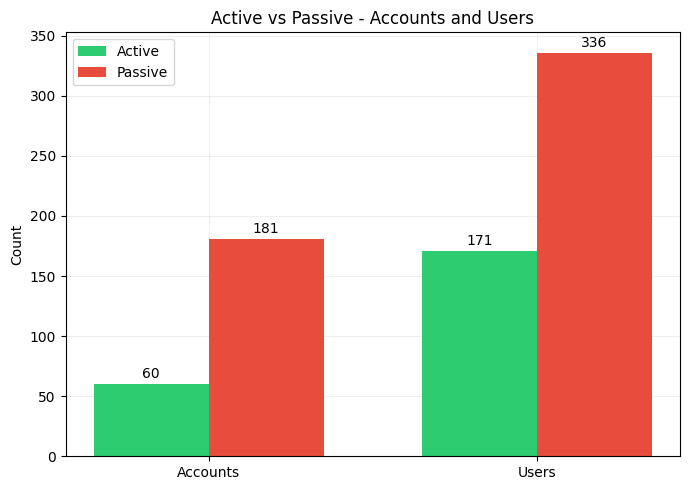

### 7.2 Connection Behaviour

CV access dominates how hirers connect.

| Method | Connections | Share |
|---|---|---|
| CV access | 5,377 | 83.1% |
| Job send | 899 | 13.9% |
| Message send | 196 | 3.0% |
| Total | 6,472 | |

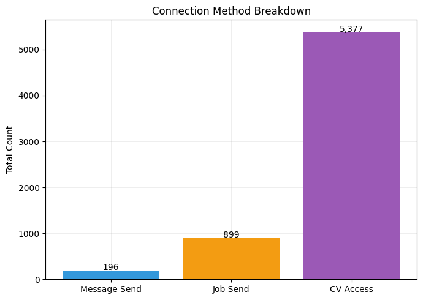

All three methods grew from November to January, led by CV access (981, then 2,037, then 2,359).

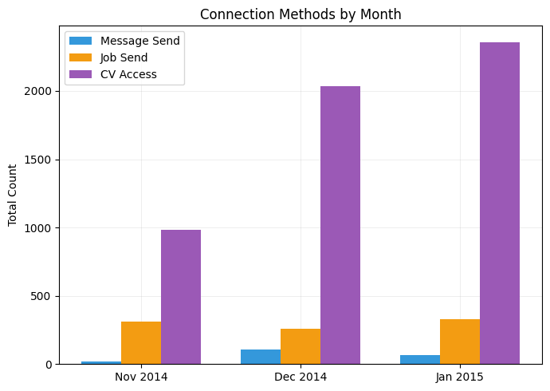

Most accounts that connected used all three methods or two. Of the 60 active accounts, 23 used all three methods, 21 used two, and 16 used one.

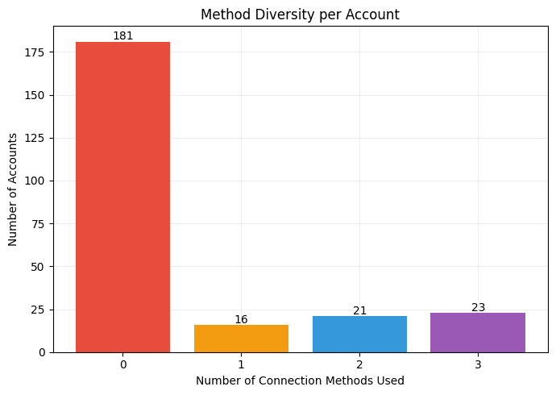

### 7.3 Credit Consumption

CV access is also where almost all credits go, because it costs 500 credits per action against 200 and 100 for the other two.

| Method | Credits | Share |
|---|---|---|
| CV access | 2,688,500 | 95.4% |
| Job send | 89,900 | 3.2% |
| Message send | 39,200 | 1.4% |
| Total | 2,817,600 | |

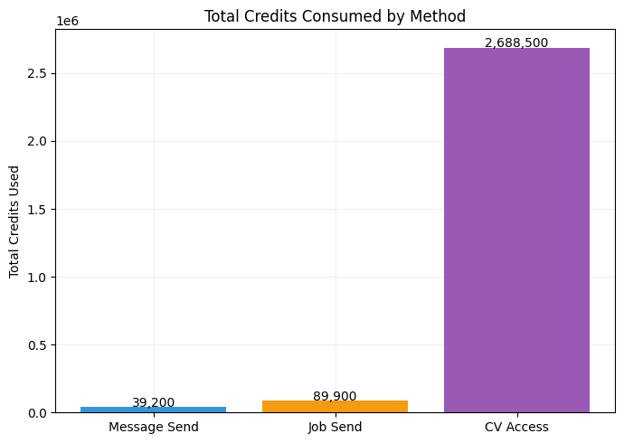

Credit use per account is extremely skewed: the median across all 241 accounts is 0, the mean is 11,691, and the maximum is 1,250,500. Among the 60 active accounts, the median is 11,850.

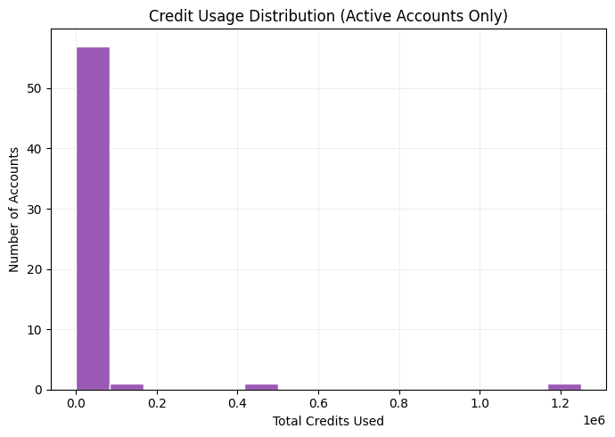

Monthly credits rose from 526,200 in November to 1,065,700 in December and 1,225,700 in January.

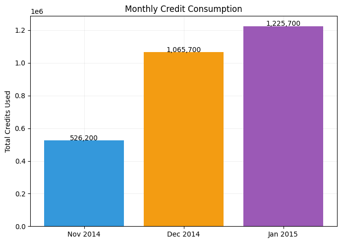

**Concentration.** The top 10% of accounts (24 accounts) used 91.6% of all credits. One account (ID 88547883) used 1,250,500 credits, which is 44.4% of the total, and the top two accounts together used 60.4%.

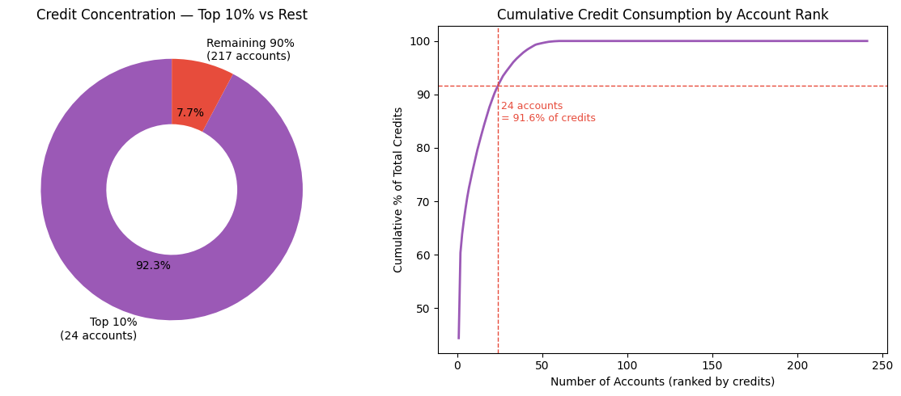

### 7.4 Account Segmentation

Accounts were grouped by credit use. Thresholds for Light and Moderate are the median (11,850 credits) and the 90th percentile (50,830 credits) of active accounts, and Heavy is anything above that.

| Segment | Accounts | Total credits | Average credits | Share of credits |
|---|---|---|---|---|
| Passive | 181 | 0 | 0 | 0% |
| Light | 30 | 147,400 | 4,913 | 5% |
| Moderate | 24 | 677,400 | 28,225 | 24% |
| Heavy | 6 | 1,992,800 | 332,133 | 71% |

Six Heavy accounts use about 71% of all credits.

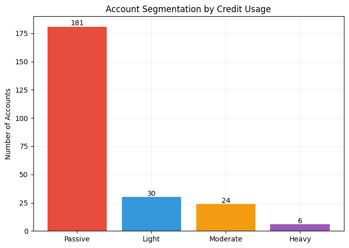

More job ads do not mean more credits. The correlation between unique job ads and credits used is only 0.22. The top account had 25 job ads, while accounts with 60 to 85 job ads used far fewer credits than it did.

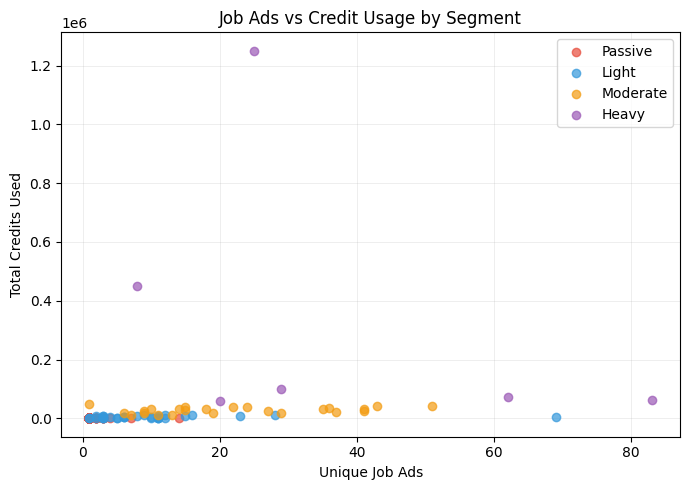

### 7.5 User Behaviour Within Accounts

Most accounts have a single user: 186 of 241 (77.2%) have one user, 55 have two or more, and the largest account has 40 users. Among active accounts the picture reverses: 47 of 60 (78.3%) have more than one user, and only 13 (21.7%) have one.

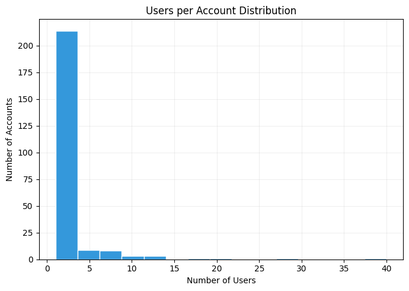

Within multi-user accounts with credit use (47 accounts), the top user accounts for a large share: on average 71% of the account's credits (median 70%). Seven of the top 10 users by credits belong to the single largest account, and the top user (ID 801200) used 350,000 credits.

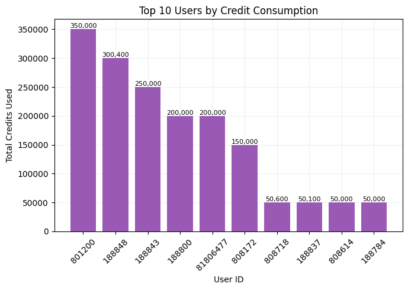

### 7.6 Monthly Trend and Adoption

| Month | Active accounts | Active users | Connections | Credits | Average credits per active account |
|---|---|---|---|---|---|
| Nov 2014 | 33 | 70 | 1,316 | 526,200 | 15,945 |
| Dec 2014 | 46 | 93 | 2,403 | 1,065,700 | 23,167 |
| Jan 2015 | 51 | 102 | 2,753 | 1,225,700 | 24,033 |

Adoption and intensity both rose: active accounts grew from 33 to 51, and average credits per active account rose by about 51%. Growth slowed in January.

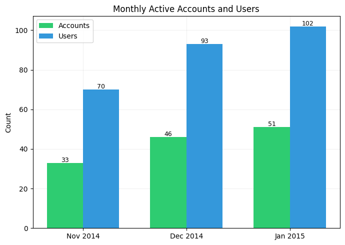

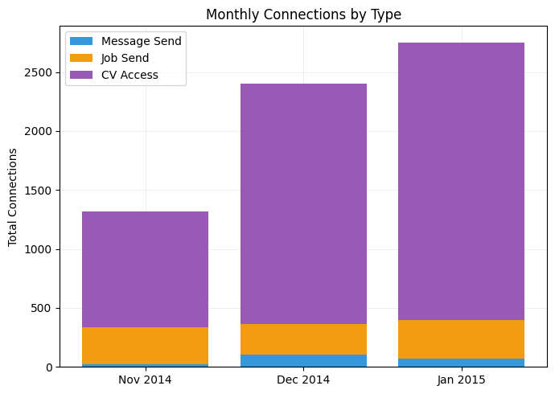

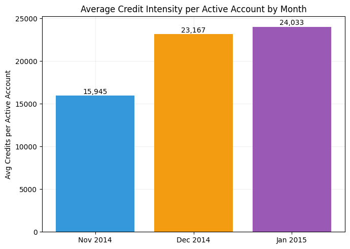

An average active account made 107.9 connections, used 46,960 credits, and worked on 17.8 job ads. The same averages across all accounts are 26.9 connections, 11,691 credits, and 5.3 job ads, pulled down by the passive accounts.

### 7.7 Risk Signals

| Risk | Finding |
|---|---|
| Credit concentration | The top 10% of accounts (24) consumed 91.6% of all credits |
| Passive accounts | 75.1% of accounts (181) never made a connection |
| CV access dependence | CV access is 95.4% of credit spend (83.1% of connections) |
| Single-user accounts | 77.2% of accounts have one user |

If CV access were capped or removed, 2,688,500 credits (95.4% of spend) would be affected.

## 8. Key Findings

Each finding is followed by a **Why (hypothesis)**: a possible explanation, not a result. The data records activity only, so none of these explanations can be confirmed from it. Each one says what additional data would test it.

**1. Usage is shallow, but deep where it exists.** 24.9% of accounts and 33.7% of users made a connection, but active rows averaged 6.2 connections per session.

- **Why (hypothesis):** every account in the data had at least one session, so the 181 passive accounts logged in but did not connect. They may have been browsing or evaluating the tool, been unable to find suitable candidates, been unsure how credits work or been out of credits, or been low-intent or trial accounts. Active hirers probably work through many candidates in one go once they have an open role, which would explain the 6.2 connections per session.
- **To test:** account age or plan, credit balance, and search activity before a connection.

**2. CV access is the main behaviour and the main cost.** It is 83.1% of connections and 95.4% of credits.

- **Why:** the credit share is partly by design. CV access is both the most frequent action and the most expensive (500 credits against 200 and 100), so it dominates spend by arithmetic.
- **Why (hypothesis):** hirers probably use CV access most because it comes first in the hiring workflow. A hirer views a CV before deciding to contact the candidate, so messages and job sends are a smaller, later step. Some contact may also happen outside the tool.
- **To test:** funnel data from CV access to message to candidate reply.

**3. Credits are highly concentrated.** The top 10% of accounts (24) used 91.6% of credits. One account used 44.4%, and six Heavy accounts used about 71%.

- **Why (hypothesis):** a few large customers, such as big employers or recruitment agencies with many recruiters and roles, probably dominate. The largest account has many users (seven of the top 10 users belong to it). This is a common pattern for paid business tools, where a small group of heavy users generates most of the usage. The top account could also be a special case, such as a test or internal account.
- **To test:** account size, industry, and plan, and whether account 88547883 is a normal customer.

**4. Credit use is not explained by job ad volume.** The correlation between job ads and credits is 0.22.

- **Why (hypothesis):** credits probably depend on how many candidates a hirer works through per ad, not on how many ads they have. Some accounts may post many ads but search lightly, while the top account spent heavily on 25 ads.
- **To test:** candidates reviewed per ad, and the type and seniority of roles.

**5. Active accounts are mostly multi-user, and one user usually does most of the work.** 78.3% of active accounts have more than one user, against 22.8% of all accounts. Within multi-user accounts, the top user makes up about 71% of credits on average.

- **Why (hypothesis):** larger hiring teams have more people searching and more roles to fill, so size may explain both the extra users and the extra activity. Within a team, one designated sourcer or power user probably does most of the searching while others use the tool occasionally.
- **To test:** account size, and whether activity rose within an account after users were added.

**6. Adoption and intensity are growing.** From November to January, active accounts rose from 33 to 51, active users from 70 to 102, and credits per active account from 15,945 to 24,033. Growth slowed in January.

- **Why (hypothesis):** several things could contribute. These include new-year hiring demand, new accounts starting to use the tool, and existing accounts using it more. Three months cannot separate them.
- **To test:** more months (ideally a full year), and a split between new and existing accounts.

**7. Risk is high on several fronts.** Concentration, passive accounts, CV access dependence, and single-user accounts all show up in the risk summary.

- **Why:** this follows from findings 1 to 5 together and needs no separate explanation.

## 9. Answer to the Problem

**Problem:** understand how customers use the candidate search tool, where credits are spent, and how dependent the business is on a few accounts.

The last column gives a possible reason for each answer. These are hypotheses, not results (see section 8 for how each could be tested).

| Question | Answer | Possible reason (hypothesis) |
|---|---|---|
| Who is engaged? | **A minority.** 60 of 241 accounts (24.9%) and 171 of 507 users (33.7%) made at least one connection in the three months. | The other accounts logged in but did not connect. They may have been browsing, trialling, unable to find suitable candidates, or unsure how credits work. |
| How do hirers connect? | **Mostly by accessing CVs.** CV access is 83.1% of connections, followed by job sends (13.9%) and messages (3.0%). | CV access is probably the first step of the hiring workflow, before a hirer decides to message or send a job. Some contact may happen outside the tool. |
| Where do the credits go? | **To CV access.** It is 95.4% of the 2.8 million credits used. | Partly by design: CV access is both the most frequent and the most expensive action (500 credits against 200 and 100). |
| Is credit use concentrated? | **Very.** The top 10% of accounts used 91.6% of credits, and one account used 44.4%. | A few large organisations or agencies with many recruiters and roles probably dominate, which is common for paid business tools. The top account may also be a special case. |
| Is usage growing? | **Yes, over these three months.** Active accounts rose from 33 to 51, and credits per active account from 15,945 to 24,033. | Possibly new-year hiring demand, new accounts ramping up, and existing accounts using the tool more. Three months cannot separate these. |
| Where are the risks? | **Concentration, passive accounts, CV access dependence, and single-user accounts.** Losing a few large accounts would remove most of the credit use. | These follow from the points above. Whether they are real dependence or just how large customers behave needs account details to judge. |

## 10. Suggested Actions

These are suggestions based on the findings. They have not been tested and should be validated with business data.

| Finding | Possible action |
|---|---|
| 75.1% of accounts never connected | Look into why (for example, onboarding or inactive accounts) and test activation prompts |
| 6 Heavy accounts use about 71% of credits | Give them account management and monitor them closely for churn |
| CV access is 95.4% of credits | Check whether the CV access price and any usage limits match the value hirers get |
| Single-user accounts are 77.2% of accounts, and active accounts are mostly multi-user | Test whether encouraging more users per account supports activity. The data shows association only |

## 11. Conclusion

The candidate search tool's usage in November 2014 to January 2015 is concentrated in a few accounts and a single behaviour. Most accounts never connected, a small group of heavy accounts drives most credit use, and CV access accounts for almost all spend. Adoption and intensity were growing, but the period is only three months. The findings are a starting point for reducing concentration risk and activating passive accounts.

The full report is available as a [Google Slides presentation](https://docs.google.com/presentation/d/e/2PACX-1vTIiT7MfzYMBrBr64b9Ah-sVCsdEefAASwz3RcwxQYz-KTT954hWZz7FhUaz2gY0GfE52SXxShVE1g2/pub?start=false&loop=false&delayms=3000&slide=id.p).

## 12. Limitations and Future Improvements

**Limitations**

1. **Only three months.** Trends over three points could be seasonal, and nothing can be said about retention.
2. **No outcome data.** There is no information on candidate replies, hires, or revenue, so the analysis shows activity and spend, not value.
3. **Conversion is not measurable.** Every row has a session, so a session-to-connection conversion rate cannot be calculated. Connections per session uses active rows only.
4. **One dominant account.** Account 88547883 used 44.4% of all credits. It was not checked whether it is a genuine customer or a special case, and it strongly shapes totals and averages.
5. **Segment thresholds are arbitrary.** Light, Moderate, and Heavy are based on percentiles of active accounts, so the labels depend on this data.
6. **No account details.** There is no information on company size, industry, or plan, so differences between accounts cannot be explained.
7. **Correlation is not causation.** For example, active accounts having more users does not show that more users cause more activity.
8. **Explanations are hypotheses.** The reasons given in the key findings are possible explanations. The data records activity only, so they cannot be confirmed without extra data such as account details, plans, or outcomes.

**Future improvements**

1. Add more months to test seasonality and retention.
2. Link credit use to outcomes such as replies or hires.
3. Study the largest account separately and show results with and without it.
4. Add account attributes and compare segments.
5. Show credit distributions on a log scale, because the current histogram is dominated by a few accounts.
6. Test the hypotheses in section 8 with account attributes, a longer history, and funnel data from CV access to candidate reply.

## 13. Project Structure

```
04-candidate-search-tool-analytics/
├── README.md
├── candidate-search-tool-analytics.ipynb
├── figures/
│   ├── 00-active-vs-passive-accounts-and-users.png
│   ├── 01-connection-method-breakdown.png
│   ├── 02-connection-methods-by-month.png
│   ├── 03-method-diversity-per-account.png
│   ├── 04-credits-consumed-by-method.png
│   ├── 05-credit-usage-distribution-active-accounts.png
│   ├── 06-monthly-credit-consumption.png
│   ├── 07-credit-concentration-top-10-percent.png
│   ├── 08-account-segmentation-by-credit-usage.png
│   ├── 09-job-ads-vs-credit-usage-by-segment.png
│   ├── 10-users-per-account-distribution.png
│   ├── 11-top-10-users-by-credit-consumption.png
│   ├── 12-monthly-active-accounts-and-users.png
│   ├── 13-monthly-connections-by-type.png
│   └── 14-average-credit-intensity-per-active-account.png
└── data/
    └── README.md
```

The data file is not committed.

## 14. How to Run

The notebook runs in **Google Colab**. It loads the data by file upload and uses Colab authentication for the optional export, so it needs Colab as written.

1. Open the notebook in Colab:

   [](https://colab.research.google.com/github/<your-username>/data-analytics-projects/blob/main/04-candidate-search-tool-analytics/candidate-search-tool-analytics.ipynb)

   You can also upload `candidate-search-tool-analytics.ipynb` to Colab yourself.

2. Run the first cell to import the libraries (pandas, NumPy, Matplotlib, and seaborn are already installed in Colab).

3. Run the loading cell and upload your copy of `Case_Study_Data.xlsx` when the file picker appears:

   ```python
   from google.colab import files
   import pandas as pd

   uploaded = files.upload()          # choose Case_Study_Data.xlsx
   file_name = next(iter(uploaded))   # use the name Colab actually saved
   df = pd.read_excel(file_name)
   ```

4. Run the remaining cells from top to bottom.

5. The final cell exports summary tables to a new Google Sheets workbook in your own Google Drive. It asks you to sign in to Google. Skip it if you do not need the export.

To run outside Colab, replace the loading cell with `df = pd.read_excel("data/Case_Study_Data.xlsx")` and skip the export cell. See [`data/README.md`](data/README.md) for the data details.